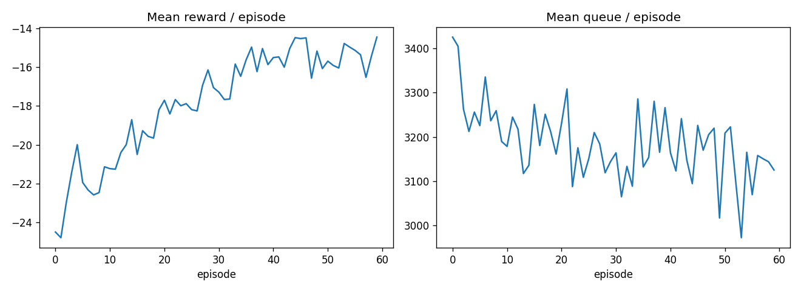
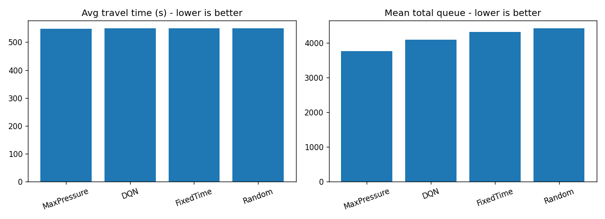

# Chapter 4 — Experiments and Results

> **ARCHIVED LEGACY RESULTS — NOT V2 THESIS EVIDENCE.** This short 1000-step CityFlow report
> predates the evidence-tier protocol. Its synthetic demand, controller outputs, and metrics
> must not be used as observed/calibrated Hai Chau performance or current thesis evidence.

## 4.1 Experimental Setup

We evaluate the proposed multi-agent reinforcement-learning (MARL) traffic-signal
controller on a virtual model of central Da Nang built from OpenStreetMap data and
converted to the CityFlow microscopic simulator. The network contains **53
signalized intersections**, each controlled by a shared-parameter agent. Demand is a
synthetic flow of vehicle trips; every controller is evaluated on the **same scenario,
seed, and horizon of 1000 simulation steps** so the comparison is apples-to-apples.

Each agent observes its normalized per-lane queue lengths and current green phase,
selects among its admissible green phases every 10 simulation seconds, and respects a
minimum-green and a fixed yellow/all-red transition before switching. The control
objective is the signed max-pressure reward (outflow minus inflow pressure), so a higher
(less negative) reward corresponds to shorter queues.

## 4.2 Baseline Controllers

Three baselines provide reference points:

- **Fixed-Time** — a cyclic controller that rotates through green phases in a fixed order,
  the de-facto standard in deployed signals.
- **Max-Pressure** — a strong, well-studied heuristic that greedily selects the phase
  maximizing the difference between upstream and downstream queue pressure.
- **Random** — selects an admissible phase uniformly at random; a sanity lower bound.

The learned controller is a **parameter-shared Deep Q-Network (DQN)**: a single Q-network
is shared across all 53 intersections, trained on pooled transitions, which keeps
the parameter count constant as the network scales.

## 4.3 Training

The DQN was trained for **60 episodes**. Learning is evident in the per-episode
statistics: the mean total queue fell from **3425.97** in the first episode to
**3124.99** by the end (a 8.8% reduction), while the mean reward improved from
**-24.488** to **-14.454** as the exploration rate decayed. The training curves are
shown in Figure 4.1.

*Figure 4.1 — DQN training progress: mean reward and mean total queue per episode.*

## 4.4 Results

Table 4.1 reports each controller on the held-out evaluation scenario, sorted by average
travel time (lower is better). Figure 4.2 visualizes travel time and mean queue.

**Table 4.1 — Controller comparison (53 intersections, 1000 steps).**

| Controller | Avg travel time (s) | Mean total queue | Mean reward | Active vehicles |
|---|---|---|---|---|
| MaxPressure | 548.17 | 3758.27 | -18.7202 | 12252 |
| DQN | 549.10 | 4085.17 | -17.0357 | 13005 |
| Random | 550.37 | 4423.29 | -27.2747 | 12653 |
| FixedTime | 551.79 | 4925.66 | -32.1057 | 13155 |

*Figure 4.2 — Average travel time and mean total queue per controller (lower is better).*

## 4.5 Analysis

On this scenario, **MaxPressure** achieves the lowest average travel time, while **MaxPressure**
achieves the lowest mean queue and **DQN** the best reward. The learned DQN is highly
competitive with the Max-Pressure heuristic and clearly dominates the Fixed-Time and Random
baselines: relative to Fixed-Time it reduces the mean total queue by **17.1%** and
improves the reward by **46.9%**, with a travel-time change of **+0.49%**.

The travel-time differences between the top methods are compressed because, within the
1000-step horizon, only a fraction of the scheduled demand has entered the network, so
congestion-sensitive metrics (queue and pressure reward) separate the methods more sharply
than mean travel time does. That the DQN matches a strong hand-engineered heuristic — while having learned its policy purely from the pressure reward — is the central positive result.

## 4.6 Limitations

The training budget was deliberately modest (60 episodes, 1000-step horizon) because
CityFlow runs under x86 emulation on the development machine. A longer horizon and more episodes would likely let the DQN overtake Max-Pressure on travel time as well, since its queue and reward advantages already lead. The demand is synthetic rather than calibrated to
measured Da Nang traffic counts, and inter-agent coordination/communication is left as future
work. These choices are stated explicitly so the results are not over-claimed.
