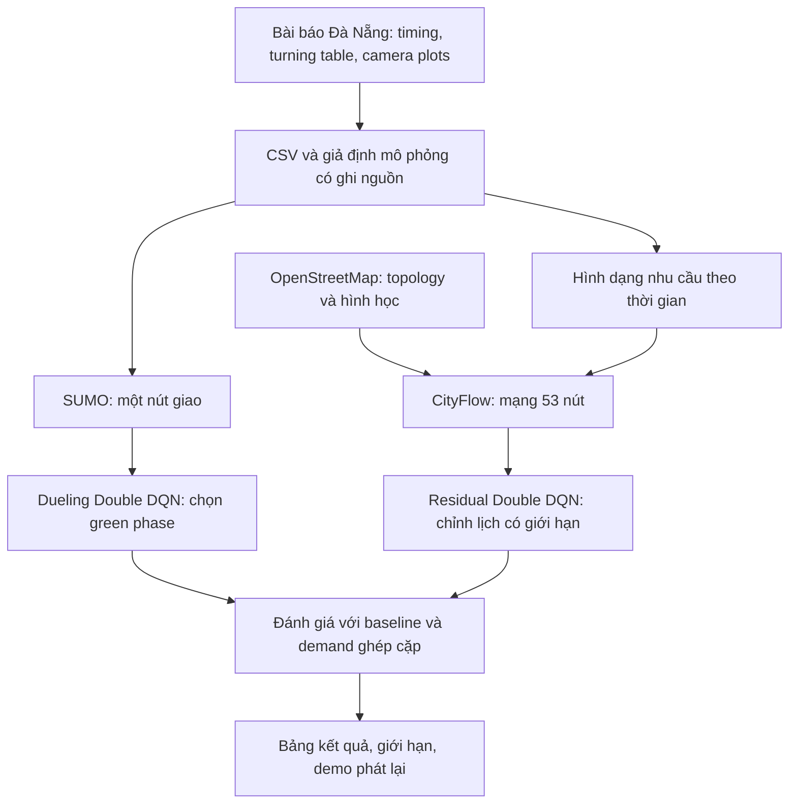

# Hiểu toàn bộ thesis: dữ liệu, mô hình, huấn luyện và cách trình bày

**Chủ đề:** học tăng cường điều khiển đèn giao thông, với một nút giao Đà Nẵng trong SUMO và mạng 53 nút có đèn ở Hải Châu trong CityFlow.  
**Cập nhật:** 24/09/2026. Đối chiếu code, cấu hình đã lưu của các lần chạy, kết quả và bộ rà soát nguồn ngày 23/09/2026.  
**Mục đích:** tài liệu tự học và kịch bản xây dựng presentation khoảng 30 phút. Các ví dụ tính toán được ghi rõ là minh họa; kết quả thực nghiệm có đường dẫn tới artifact tương ứng.

> **Luận điểm trung tâm:** thesis kiểm tra khi nào điều khiển thích nghi giảm hàng chờ trong những kịch bản mô phỏng có kiểm soát. Kết quả phụ thuộc chế độ nhu cầu và baseline; bằng chứng hiện có chưa xác nhận hiệu quả vận hành thực địa. Hai phần SUMO và CityFlow dùng hai kiến trúc và hai quy trình train khác nhau.


## Cách đọc

- **Lần đầu, 30–45 phút:** đọc mục 1–5, 8, 14–17 và 21 để nắm câu chuyện.
- **Học model và bảo vệ kỹ thuật:** đọc mục 6–13, 18–20 và 22–24; mở các file code được dẫn.
- **Làm slide:** dùng mục 21 làm khung; lấy hình và bảng từ mục 15–16, 25.
- **Chuẩn bị phản biện:** đọc mục 22 và [29 câu hỏi kèm bằng chứng](committee-questions-evidence-vi.md).
- **Kiểm tra một con số hoặc nguồn:** đọc [sổ truy vết bằng chứng](../research/thesis-evidence-ledger.md), [báo cáo kiểm chứng](../research/thesis-review-verification.md) và [bản thesis PDF](../../paper/thesis_danang.pdf).


### Mục lục

1. [Thesis thực sự làm gì?](#s01)
2. [Bản đồ hai hệ thống](#s02)
3. [Dữ liệu đến từ đâu?](#s03)
4. [Từ dữ liệu nguồn đến nhu cầu mô phỏng](#s04)
5. [Từ vựng và các loại thời gian](#s05)
6. [RL, DQN, Double DQN và dueling](#s06)
7. [SUMO: state, action, reward và kiến trúc](#s07)
8. [SUMO: train, validation và test](#s08)
9. [CityFlow: ý tưởng residual theo lịch đèn](#s09)
10. [CityFlow: 27 features và mạng chấm điểm macro](#s10)
11. [CityFlow: reward, replay và huấn luyện](#s11)
12. [CityFlow: chọn checkpoint và fallback](#s12)
13. [Bảng tham số và ý nghĩa khi thay đổi](#s13)
14. [Baseline, simulator và giả định phương tiện](#s14)
15. [Metric và cách hiểu độ tin cậy](#s15)
16. [Kết quả thực nghiệm phải trình bày thế nào?](#s16)
17. [Lịch sử thay đổi và bài học](#s17)
18. [Công nghệ và bản đồ mã nguồn](#s18)
19. [Cách chạy và giới hạn tái lập](#s19)
20. [Demo: nói gì, thao tác gì?](#s20)
21. [Kịch bản presentation 30 phút](#s21)
22. [Câu hỏi kỹ thuật và câu trả lời mẫu](#s22)
23. [Glossary Việt–Anh](#s23)
24. [Checklist tự kiểm tra trước bảo vệ](#s24)
25. [Bản đồ bằng chứng và tài liệu tham khảo](#s25)


## 1. Thesis thực sự làm gì?


### 1.1. Bài toán

Một lịch đèn cố định phân chia thời gian xanh theo lịch lặp. Khi lưu lượng giữa các hướng thay đổi, lịch đó có thể cấp xanh cho hướng ít xe trong khi hướng khác đang ùn. Bộ điều khiển thích nghi quan sát giao thông và thay đổi quyết định để giảm tổng hàng chờ.

Khó khăn nằm ở ba việc:

1. **Tác động xuất hiện trễ:** đổi đèn hiện tại có thể làm hàng xe giảm sau nhiều giây và ảnh hưởng các nút kế tiếp.
2. **Lợi ích có thể xung đột:** giải phóng một nút có thể đẩy xe vào đoạn đường phía sau đã đầy.
3. **Bằng chứng có giới hạn:** dữ liệu camera công bố chỉ bao phủ một phần movement tại một nút; toàn mạng cần giả định về routes, flows và lịch đèn.


### 1.2. Ba câu hỏi nghiên cứu để dùng trên slide


| Câu hỏi                                                                               | Thí nghiệm trả lời                                       | Phạm vi kết luận                                          |
| ------------------------------------------------------------------------------------- | -------------------------------------------------------- | --------------------------------------------------------- |
| RL có giảm hàng chờ tại nút giao có dữ liệu công bố không?                            | SUMO, ba chế độ nhu cầu, nhiều learning seed             | Nút mô phỏng với hình học, demand và giả định đã mô tả    |
| Một policy dùng chung cho 53 nút có thể học các chỉnh sửa lịch hữu ích không?         | CityFlow, schedule-residual DDQN                         | Khả năng hoạt động trên mạng mô phỏng và dữ liệu tổng hợp |
| Kết quả còn đáng tin sau khi xét baseline mạnh, seed, pending và nguồn dữ liệu không? | Đối chiếu baseline, thống kê, selector và evidence audit | Bằng chứng hiện có và các khoảng trống còn lại            |


### 1.3. Đóng góp nên nhận

- Tổ chức **hai tầng nghiên cứu**: một nút có nguồn thực nghiệm công bố và một mạng mở rộng dùng topology OSM.
- Triển khai, giải thích và đánh giá các controller với state/action/reward rõ ràng.
- Xây dựng residual action có thể truy vết: dịch một ranh giới lịch đèn, kiểm tra tính hợp lệ và quay về trạng thái tín hiệu tham chiếu cuối block.
- Đánh giá có ghép cặp demand, tách learning seed, cộng xe đã đến hạn nhưng chưa vào mạng vào chi phí, và công khai các kết quả xấu.
- Tạo chuỗi truy vết từ nguồn → dữ liệu biến đổi → cấu hình → checkpoint → kết quả → demo.

**Không nhận là đóng góp đã chứng minh:** phát minh Double DQN/dueling, đạt state of the art toàn ngành, cải thiện toàn thành phố, hoặc sẵn sàng điều khiển đèn ngoài đường. Mức độ mới của residual controller cần được đặt trong related work; việc có triển khai riêng không tự chứng minh tính mới học thuật.

### 1.4. Pitch 60 giây

> Em nghiên cứu điều khiển đèn giao thông bằng học tăng cường theo hai tầng. Ở một nút giao Đà Nẵng, em dựng mô phỏng SUMO từ dữ liệu công bố và đánh giá dueling Double DQN. Ở mạng 53 nút Hải Châu, em dùng CityFlow với hình học OSM và nhu cầu tổng hợp, cho một policy dùng chung chọn các chỉnh sửa nhỏ của lịch đèn. Em đánh giá trên cùng demand, nhiều seed và tính cả xe chưa vào được mạng. Kết quả cho thấy lợi ích phụ thuộc chế độ nhu cầu: SUMO cải thiện rõ ở PM nhưng xấu hơn ở normal; trên mạng, Max-Pressure vẫn tốt hơn residual DDQN trong ma trận hiện có. Đóng góp của thesis là hệ thống mô hình hóa, điều khiển và đánh giá có truy vết, cùng phân tích rõ giới hạn của bằng chứng.


## 2. Bản đồ hai hệ thống


| Thành phần             | SUMO: một nút giao                         | CityFlow: mạng Hải Châu                                            |
| ---------------------- | ------------------------------------------ | ------------------------------------------------------------------ |
| Vai trò                | Kiểm tra tại nút có nguồn công bố          | Kiểm tra khả năng mở rộng và tương tác giữa nút                    |
| Quy mô                 | Một nút, bốn approach, ba green phase      | 53 nút có đèn                                                      |
| Model chính            | Dueling **Double** DQN, n-step = 3         | Schedule-residual **Double** DQN                                   |
| Đầu vào neural network | Vector 16 số                               | Vector 27 số **cho mỗi macro ứng viên**                            |
| Đầu ra                 | Ba Q-value cho ba green phase              | Một Q-value cho mỗi macro; chấm các macro bằng cùng MLP            |
| Hidden layers          | 64 → 64, ReLU                              | 64 → 64, ReLU                                                      |
| Dueling heads          | Có: V và A                                 | Không                                                              |
| Agent/policy           | Một nút, một policy                        | 53 quyết định cục bộ, **chung một bộ trọng số**                    |
| Nhịp quyết định RL     | 10 giây                                    | 300 giây; bên trong có request mỗi 10 giây                         |
| Reward train           | Âm queue tại cuối bước 10 giây, scale 0,01 | Âm queue integral toàn mạng + pending trong block, scale 1/100.000 |
| Thời lượng train chính | 30 episode × 3.600 giây/seed               | 12 episode × 3.600 giây/seed                                       |
| Learning seeds chính   | 11–15                                      | 12–16                                                              |
| Baseline fixed         | Lịch công bố 103 giây                      | Fixed có nominal green 25 giây, chọn trên validation               |
| Test                   | 15 ca, ba regime                           | 15 ca, ba regime                                                   |
| Lưu ý                  | Học trên AM, kiểm tra cả normal/AM/PM      | Train residual trên peak; normal chạy fixed từ thiết kế            |





**Không có chuyển trọng số từ SUMO sang CityFlow trong kết quả này.** Hai phần nối với nhau qua câu hỏi nghiên cứu và nguồn bối cảnh nhu cầu; không phải pipeline train SUMO rồi fine-tune cùng model trên CityFlow.

## 3. Dữ liệu đến từ đâu?


### 3.1. Nguồn gốc có thể đưa ra trước hội đồng

Nguồn chính là Phan, Le và Nguyen (2025), *Application of Dueling Double Deep Q-Network for Dynamic Traffic Signal Optimization: A Case Study in Danang City, Vietnam*, DOI [10.3390/make7030065](https://doi.org/10.3390/make7030065). Dự án có [PDF nguồn lưu cục bộ](../../datasets/danang_published/sources/phan2025_make7030065.pdf).

Bảng dưới dùng **số trang PDF 1–24**:


| Nội dung                                        | Vị trí trong nguồn                          | Dự án sử dụng thế nào?                          | Giới hạn                                                        |
| ----------------------------------------------- | ------------------------------------------- | ----------------------------------------------- | --------------------------------------------------------------- |
| Hình học và số làn 2/2/3/3                      | Trang 7                                     | Dựng nút SUMO                                   | Nguồn ghi tên đường không nhất quán                             |
| Green 32/28/22 giây, chu kỳ 103 giây            | Trang 7; Hình 4 trang 8 có ba yellow 7 giây | Baseline published fixed                        | Là timing công bố, chưa có survey độc lập hiện tại              |
| 12 turning movements, tổng 6.171 PCU/h          | Bảng 1 trang 8; nguồn volume năm 2022       | Bối cảnh phân bổ movement                       | PCU/h khác veh/h; tài liệu gốc tham chiếu chưa thu thập độc lập |
| Camera ngày 01/04/2025, khung 06:00–18:00       | Trang 16                                    | Xác định thời điểm nguồn camera                 | Một ngày; không suy ra tính đại diện nhiều mùa                  |
| Hai camera, bốn đường đo movement               | Hình 12 trang 17                            | Xác định phần giao thông thực sự được biểu diễn | Không bao phủ mọi movement của nút                              |
| Hệ số PCU: xe máy 0,3; ô tô 1; bus 2; truck 2,5 | Trang 19                                    | Hiểu quy đổi của bài nguồn                      | PCU là xe con tương đương, không phải số phương tiện            |
| Biểu đồ số xe theo giờ và loại xe               | Hình 17–18 trang 20                         | Đọc xấp xỉ thành CSV                            | Không có raw video hay bảng detector gốc                        |
| Điều kiện cung cấp dữ liệu, quyền riêng tư      | Trang 23                                    | Mô tả khả năng tiếp cận raw data                | Raw data không được tải trực tiếp cùng bài                      |


Tên nút trong thesis dùng **Lê Thanh Nghị – Cách Mạng Tháng 8 – 2/9, phía cầu Hòa Xuân**, theo Bảng 1/Hình 12. Trang 7 của bài nguồn có biến thể `Nguyenthanhnghi`. ID cũ `danang_ntn_cmt8_29` trong repo là tên kỹ thuật lịch sử; cần công khai sự không nhất quán này.

### 3.2. Những gì thực sự nằm trong CSV

[Camera CSV](../../datasets/danang_published/phan2025_camera_hourly_digitized.csv) có:

- 4 movement: SW→NE, SW→NW, NW→SE, NW→NE.
- 12 nhãn giờ, từ 07:00 đến 18:00.
- 48 dòng = 4 movement × 12 nhãn giờ, cho **một ngày nguồn**.
- Bốn lớp xe trên mỗi dòng: car, motorcycle, truck, bus; tổng cộng 192 giá trị xấp xỉ đọc từ biểu đồ.

Tổng bốn đường đo tại nhãn 08:00 là 2.330 xe, 13:00 là 1.395 xe, 17:00 là 2.400 xe. Đây là tổng trên bốn đường đo được biểu diễn. Những giá trị này không thể gán trực tiếp thành tổng quan sát của cả nút hoặc cả quận.

Tên cột `hour_start` được giữ từ pipeline cũ; bài nguồn không làm rõ mọi quy ước đầu/cuối bin. Khi trình bày nên gọi là **nhãn giờ của biểu đồ**. Các dung sai đọc ±15/±30 veh/h do dự án đặt ra là sai số đọc gần đúng, chưa phải confidence interval hoặc độ chính xác detector. Chưa có log trích tọa độ biểu đồ đầy đủ và chưa truyền sai số này qua toàn bộ thí nghiệm.

[Turning CSV](../../datasets/danang_published/tran2025_peak_turning_movements.csv) giữ tên file lịch sử `tran2025`, nhưng nguồn đã xác minh là bài **Phan et al.** Nên dẫn tác giả theo bài báo, không theo tên file. Nhãn `mixed` là phân loại thận trọng của dự án. Câu của bài nguồn về ước lượng movement không quan sát thuộc camera 2025; nó không xác định chính xác dòng nào của bảng volume 2022 là ước lượng.

### 3.3. Bốn tầng độ tin cậy


| Tầng                | Ví dụ                                              | Cách nói đúng                               |
| ------------------- | -------------------------------------------------- | ------------------------------------------- |
| Nguồn công bố       | PDF, timing, turning table, biểu đồ camera         | “Theo bài báo tại trang/hình/bảng…”         |
| Trích xuất từ nguồn | Các số đọc xấp xỉ trong CSV                        | “Digitized approximate counts từ biểu đồ…”  |
| Dựng mô phỏng       | Full-junction expansion, routes, vehicle templates | “Giả định/ước lượng dùng để dựng kịch bản…” |
| Đầu ra mô phỏng     | Queue integral, completion, reward                 | “Kết quả trong simulator với cấu hình…”     |


SHA-256 chứng minh file được dùng có đúng byte như artifact đã ghi nhận. Hash không chứng minh con số mô tả đúng giao thông ngoài đời. Xem [audit dữ liệu](../research/danang-data-claim-audit.md) và [README dataset](../../datasets/danang_published/README.md).

### 3.4. Nguồn topology OSM và các bước biến đổi

[Provenance mạng](../../datasets/haichau_network_v2/provenance.json) ghi nguồn extract là Geofabrik, đầu vào `vietnam-latest.osm.pbf`, giấy phép OSM ODbL. Bounding box WGS84 là west/south/east/north = **108.1888, 16.0213, 108.2360, 16.1037**. Chuỗi chuyển đổi được ghi là:

```text
Vietnam OSM PBF → osmium extract/cat → clipped OSM
               → SUMO netconvert → SUMO network XML
               → CityFlow converter → roadnet JSON
               → kiểm tra/chuẩn hóa phase contract của nghiên cứu
```

Commands có thao tác gộp junction, đoán signal, bỏ turnaround, lọc một số loại đường và giữ connected component. Vì vậy đây là **mạng suy dẫn đã qua xử lý**, không phải toàn bộ đường và toàn bộ đèn hiện trường nguyên trạng. Con số 53 là số controlled signals của model.

Provenance còn ghi một sửa đổi synthetic ở nút `5896811072`: tách action gộp thành hai green để các movement có thể được điều khiển riêng. Nó không được coi là lịch đèn do cơ quan quản lý cung cấp. File nguồn cắt vùng và các hash có trong provenance, nhưng ngày tải OSM, version osmium/netconvert và digest converter lịch sử được ghi `unknown_not_recorded`. Không thể lấy URL có chữ `latest` để khẳng định ngày snapshot đã dùng hoặc tự điền metadata còn thiếu.

## 4. Từ dữ liệu nguồn đến nhu cầu mô phỏng


### 4.1. Tầng SUMO

Pipeline khái niệm:

```text
Timing + hình học công bố  →  nút giao và chương trình đèn
Camera CSV, bốn movement   →  demand của protocol SUMO chính
Demand seed               →  route/departure schedule trong .rou.xml
Simulator seed            →  ngẫu nhiên bên trong SUMO
Controller                →  lịch đèn thực thi
                           →  queue, pending, arrived, sự kiện an toàn
```

Protocol chính `danang_observed_camera_v1` dùng **1.395 xe normal, 2.330 xe AM và 2.400 xe PM trong một giờ**, tương ứng các tổng trên bốn movement camera. Learning train/validation dùng AM 2.330 xe; demand seed tạo các lịch khởi hành khác nhau. Đây là bài toán với phần demand được nguồn camera hỗ trợ, chưa tái hiện đầy đủ mọi movement của nút.

Các mức full-junction khoảng 5.793/9.676/9.967 xe ở tài liệu dựng demand là **ước lượng mở rộng của dự án**, không phải số camera đếm trực tiếp toàn nút và không phải scheduled counts của protocol chính trên. Turning table phục vụ bối cảnh/phương án dựng mở rộng. Khi cần giải thích, mở [pilot calibration](../research/pilot-calibration.md) và [manifest SUMO](../../results/danang_protocol_v1/experiment-manifest.json). Không cộng số PCU và số phương tiện như cùng một đơn vị.

### 4.2. Tầng CityFlow

[Config mạng](../../configs/haichau_network_v2.yaml) và [mã dựng demand](../../src/traffic_rl/network/haichau_dataset.py) quy định:


| Thuộc tính               | Giá trị/ý nghĩa                                                     |
| ------------------------ | ------------------------------------------------------------------- |
| Controlled intersections | 53                                                                  |
| Route families           | 1.290, chia train/validation/test = 644/323/323                     |
| Route streams mỗi case   | 500; mỗi stream phát sinh nhiều xe theo interval                    |
| Một route                | Đi qua ít nhất hai controlled signals                               |
| Coverage                 | Mọi signal có route coverage ở từng split và từng case              |
| Mức đa dạng coverage     | Ít nhất ba route families/signal                                    |
| Giới hạn kéo dài route   | Stretch ratio tối đa 1,25 theo cách dựng route                      |
| Vehicle mix              | Mỗi route stream được gán motorcycle với xác suất 0,90; còn lại car |
| Episode                  | 3.600 giây, gồm ba bin 1.200 giây                                   |
| Mức tham chiếu phát xe   | Interval 240 giây, được thay đổi theo profile                       |


**500 routes không có nghĩa 500 xe.** Một route stream có thể phát nhiều xe trong một giờ; số scheduled thực tế phải đọc manifest/flow của case đó. Xác suất xe máy 90% áp dụng khi gán loại cho route stream; đó là giả định lấy mẫu, không phải đo hiện trường cho toàn Hải Châu và không buộc mọi case có tỷ lệ xe đúng 90,000%.

Profile dùng các tổng nguồn sau:


| Regime  | Bin 0–1.200 s     | Bin 1.200–2.400 s | Bin 2.400–3.600 s |
| ------- | ----------------- | ----------------- | ----------------- |
| Normal  | Nhãn 12:00: 1.910 | 13:00: 1.395      | 14:00: 1.505      |
| AM peak | 07:00: 1.255      | 08:00: 2.330      | 09:00: 1.870      |
| PM peak | 16:00: 1.755      | 17:00: 2.400      | 18:00: 2.490      |


Công thức interval trong config:

```text
normal_mean = (1910 + 1395 + 1505) / 3 = 1603,333...
interval_bin = 240 × normal_mean / source_count_bin
```

Ví dụ bin nguồn 2.400 xe cho interval khoảng 160,33 giây; lượng nguồn cao hơn làm interval ngắn hơn, tức phát xe dày hơn. Đây là cách dùng **hình dạng tương đối của nhu cầu** để điều biến demand tổng hợp.

Ba nhãn giờ nguồn được nén thành ba đoạn 20 phút của một giờ mô phỏng. Vì vậy case PM không phải phát lại nguyên ba giờ thực địa 16:00–19:00. Bus/truck góp vào tổng profile nguồn, trong khi demand CityFlow hiện dùng hai vehicle templates motorcycle/car.

### 4.3. Chia dữ liệu và các trục seed


| Split CityFlow | Demand seeds | Simulator seeds ghép tương ứng | Cases             |
| -------------- | ------------ | ------------------------------ | ----------------- |
| Train          | 11, 12, 13   | 111, 112, 113                  | 3 regime × 3 = 9  |
| Validation     | 31, 32       | 131, 132                       | 3 regime × 2 = 6  |
| Test           | 101–105      | 201–205                        | 3 regime × 5 = 15 |


Ba loại seed có ý nghĩa khác nhau:

- **Demand seed:** quyết định lấy mẫu route/vehicle/departure trong bộ dựng nhu cầu.
- **Simulator seed:** điều khiển phần ngẫu nhiên của simulator theo cấu hình chạy.
- **Learning seed:** khởi tạo neural network, exploration và lấy mẫu replay.

So sánh hai controller trên cùng demand/simulator seed giúp giảm nhiễu do khác đầu vào. Nhiều learning seed đánh giá độ biến thiên của việc học. Không được gọi nhiều demand case của cùng checkpoint là nhiều model học độc lập.

Route-family split tách các họ tuyến theo protocol, nhưng các tuyến vẫn có thể đi qua cùng đoạn đường và cùng nút trên topology này. Đây không phải đánh giá trên một thành phố chưa xuất hiện trong training. Các demand realizations cũng không biến nguồn camera một ngày thành nhiều ngày khảo sát độc lập.

## 5. Từ vựng và các loại thời gian


| Khái niệm                 | Nghĩa và ví dụ                                                                        |
| ------------------------- | ------------------------------------------------------------------------------------- |
| Approach                  | Nhánh đi vào nút; SUMO dùng NW, SE, NE, SW                                            |
| Movement                  | Một chuyển động từ nhánh vào sang nhánh ra, ví dụ SW→NE                               |
| Phase                     | Tập movement được phép đi trong một trạng thái đèn                                    |
| Green phase               | Phase cung cấp quyền đi; chỉ số action có thể khác chỉ số phase trong simulator       |
| Clearance/intergreen      | Khoảng chuyển tiếp giữa các green, có thể gồm yellow và trạng thái khác theo contract |
| Minimum green             | Thời gian xanh tối thiểu trước khi cho chuyển                                         |
| Maximum red/service timer | Ràng buộc tránh quá lâu không phục vụ một movement trong cơ chế mạng                  |
| Queue                     | Số xe mà simulator phân loại là đang chờ; không đồng nhất với mọi xe có trên lane     |
| Pending                   | Xe đã đến thời điểm xuất hiện nhưng chưa vào được mạng                                |
| Unreleased                | Xe có lịch xuất hiện trong tương lai; chưa tính là pending                            |
| Spillback                 | Hàng xe kéo ngược gây cản trở upstream; metric của dự án dùng proxy theo ngưỡng lane  |
| Regime                    | Chế độ nhu cầu: normal, AM peak, PM peak                                              |


### Ba đồng hồ cần phân biệt

1. **Simulator second:** simulator tiến một giây, metric integral được cộng mỗi giây.
2. **Control tick 10 giây:** SUMO chọn phase; CityFlow thực thi một request của macro.
3. **Macro 300 giây:** CityFlow residual chọn một kế hoạch chỉnh sửa cho block kế tiếp.

Ngoài ra còn có **optimizer update**: một lần cập nhật trọng số từ minibatch. Nó không phải giây mô phỏng. Một episode 3.600 giây là một giờ **thời gian mô phỏng**, không mặc định mất một giờ trên máy.

## 6. RL, DQN, Double DQN và dueling


### 6.1. Vòng lặp RL

```text
Quan sát giao thông o_t
    → policy chọn action a_t
    → simulator thực thi action
    → nhận reward r_t và quan sát o_(t+1)
    → lưu experience và cập nhật model trong training
```

RL không cần bộ nhãn “đây là action tối ưu” cho từng trạng thái. Nó học từ hậu quả của action trong môi trường. Reward âm biểu diễn chi phí; **ít âm hơn là tốt hơn**.

MDP là mô hình gồm state, action, transition, reward và discount. Trong code, đầu vào chỉ là tập features tóm tắt. Đặc biệt trên mạng, một agent không nhìn đầy đủ vị trí/vận tốc của mọi xe; coi các observations này là Markov hoàn hảo là một giả định xấp xỉ. Mô tả “quan sát cục bộ có thông tin lân cận” chính xác hơn “biết toàn bộ trạng thái giao thông”.

### 6.2. Q-value

Q(o,a) dự đoán tổng reward có chiết khấu khi chọn action a tại observation o, rồi tiếp tục theo policy. Q cao hơn nghĩa chi phí kỳ vọng thấp hơn khi reward là âm chi phí.

```text
Return = r_t + γ r_(t+1) + γ² r_(t+2) + ...
Greedy action = argmax_a Q(o, a)
```

Một Q-value không phải trực tiếp là “số xe giải phóng”. Đơn vị và độ lớn của nó phụ thuộc reward scaling, discount và độ dài bước.

### 6.3. Tại sao cần Double DQN?

DQN thông thường dùng phép max của cùng một bộ ước lượng để chọn và đánh giá action trong target, có thể khuếch đại sai số lạc quan. Double DQN tách hai vai trò:

```text
Online network θ:  a* = argmax_a Q_online(o_next, a)
Target network θ−: đánh giá Q_target(o_next, a*)
Target y = r + (1 − done) × γ × Q_target(o_next, a*)
```

Ví dụ minh họa: online dự đoán action A = −4, B = −5 nên chọn A. Target dự đoán A = −6, B = −3; Double DQN lấy **−6 tại A** để tính target, dù target network thích B hơn. Target network được copy định kỳ từ online để mục tiêu học thay đổi chậm hơn. Cơ chế này được đề xuất trong [van Hasselt, Guez và Silver, Deep Reinforcement Learning with Double Q-learning](https://arxiv.org/abs/1509.06461).

### 6.4. Dueling khác Double ở đâu?

Dueling là cách xây **đầu ra mạng**, tách:

- V(o): giá trị chung của trạng thái.
- A(o,a): lợi thế tương đối của action.

```text
Q(o,a) = V(o) + A(o,a) − mean_b A(o,b)
```

Trừ trung bình advantage giúp cố định cách phân rã V/A. Ý tưởng hữu ích khi nhiều action có giá trị gần nhau và mạng vẫn cần học trạng thái đang tốt hay xấu. Đây là động cơ thiết kế, không tự bảo đảm cải thiện mọi regime. Tham khảo [Wang et al., Dueling Network Architectures for Deep Reinforcement Learning](https://proceedings.mlr.press/v48/wangf16.html).

**Double** = cách dựng target. **Dueling** = cách chia heads. Có thể dùng đồng thời. Model SUMO dùng cả hai; model residual CityFlow dùng Double và một scalar head.

### 6.5. Replay, exploration, loss và optimizer


| Cơ chế            | Để làm gì?                                                      | Trong dự án                                             |
| ----------------- | --------------------------------------------------------------- | ------------------------------------------------------- |
| Replay buffer     | Tái sử dụng kinh nghiệm, giảm phụ thuộc vào chuỗi mẫu liên tiếp | Ring buffer, lấy mẫu ngẫu nhiên có hoàn lại             |
| Epsilon-greedy    | Khám phá thay vì luôn chọn action đang được dự đoán tốt nhất    | Xác suất ε chọn ngẫu nhiên trong action hợp lệ          |
| Huber loss        | Bình phương lỗi nhỏ, tuyến tính với lỗi lớn                     | δ = 1; hạn chế gradient quá lớn do TD error             |
| Gradient clipping | Chặn chuẩn L2 toàn bộ gradient                                  | Ngưỡng 10; không phải chặn trọng số tại ±10             |
| Adam              | Cập nhật theo moment của gradient                               | β1 = 0,9; β2 = 0,999; epsilon số học = 1e−8             |
| ReLU              | Tạo phi tuyến trong hidden layers                               | ReLU(x) = max(0, x)                                     |
| He initialization | Đặt scale trọng số ban đầu phù hợp ReLU                         | Scale sqrt(2/fan_in) ở các lớp được khởi tạo ngẫu nhiên |


Với TD error δt = Q − y, Huber loss bằng 0,5δt² nếu |δt| ≤ 1, và |δt| − 0,5 nếu lớn hơn 1. Adam epsilon là hằng số ổn định phép chia; epsilon-greedy là xác suất exploration. Hai epsilon này khác chức năng.

## 7. SUMO: state, action, reward và kiến trúc

Nguồn trực tiếp: [environment SUMO](../../src/traffic_rl/sim/sumo_single_junction.py), [SharedDQN](../../src/traffic_rl/agents/dqn.py), [config](../../configs/danang_pilot.yaml).

### 7.1. Vector 16 chiều gồm gì?

Thứ tự approach là NW, SE, NE, SW:


| Vị trí, đếm từ 1 | Features                                           | Chuẩn hóa                    |
| ---------------- | -------------------------------------------------- | ---------------------------- |
| 1–4              | Queue từng approach                                | Chia 20                      |
| 5–8              | Vehicle count từng approach, gồm xe chạy và xe chờ | Chia 20                      |
| 9–12             | Pending đã đến hạn theo approach                   | Chia 20                      |
| 13–15            | One-hot green phase hiện tại                       | Một phần tử 1, hai phần tử 0 |
| 16               | Thời gian kể từ lần chuyển                         | min(elapsed, 60)/60          |


Ví dụ minh họa: queue 10 xe cho feature 0,5. Count normalization không đồng nghĩa mọi feature đều bị cắt vào [0,1]; queue 40 xe có thể thành 2. One-hot giúp model phân biệt đang phục vụ phase nào.

### 7.2. Action và thực thi chuyển đèn

Model trả ba Q-value, tương ứng action 0/1/2. Environment ánh xạ chúng sang green phase index 0/2/4 của chương trình SUMO; các phase 1/3/5 là yellow.

- Mỗi lần gọi `step` tiến tổng cộng 10 giây.
- Nếu chuyển hợp lệ, có 7 giây yellow rồi phần thời gian còn lại ở green mới.
- Minimum green = 20 giây, kiểm tra khi thực thi.
- Action mask của environment SUMO hiện cho cả ba action. Nếu yêu cầu chuyển quá sớm, environment giữ phase hiện tại.

Do nhịp ra quyết định 10 giây và thời gian yellow, green thực tế có thể dài hơn ngưỡng tối thiểu. Không mô tả action của model thành lệnh bật đèn ngay tức khắc bỏ qua transition. Ràng buộc maximum red 180 giây ở phần mạng không được tự gán sang SUMO.

### 7.3. Neural network

```text
16 features
   ↓ Linear(16,64) + ReLU
64 hidden units
   ↓ Linear(64,64) + ReLU
64 hidden units
   ├── Value head:     Linear(64,1) → V
   └── Advantage head: Linear(64,3) → A0, A1, A2
   ↓ Q_a = V + A_a − mean(A)
3 Q-values → argmax → action
```

Số tham số online suy ra từ kích thước lớp:

```text
(16×64 + 64) + (64×64 + 64) + (64×1 + 1) + (64×3 + 3)
= 5.508 tham số
```

Target network giữ thêm một bản trọng số. Các state của Adam cũng chiếm bộ nhớ. Con số 5.508 chỉ đếm model online, không phải tổng bộ nhớ của quá trình train.

Biến thể `dqn_base` có đầu ra ba Q trực tiếp, không dueling, n-step = 1; vẫn dùng phép chọn/đánh giá của **Double DQN** trong implementation. Vì vậy nhãn file “base DQN” không nên được giải thích thành vanilla DQN target.

### 7.4. Reward và n-step return

Environment lấy tổng queue incoming và pending đến hạn tại **cuối bước 10 giây**, đổi dấu âm. Trainer nhân `reward_scale = 0.01`.

```text
r_train(t) = −0,01 × [queue_incoming(t_end) + pending_due(t_end)]
R3 = r_t + γ r_(t+1) + γ² r_(t+2)
a* = argmax_a Q_online(o_(t+3), a)
y = R3 + (1 − done) × γ³ × Q_target(o_(t+3), a*)
```

Khi episode kết thúc, accumulator flush các đoạn ngắn còn lại và không bootstrap qua terminal. γ = 0,99 **mỗi decision 10 giây**, không phải mỗi giây.

**Phân biệt quan trọng:** reward và validation mean queue là mẫu ở cuối bước 10 giây; metric chính được tích phân mỗi giây. Chúng cùng hướng giảm hàng chờ nhưng không phải phép tính giống hệt. n-step = 3 giúp reward truyền qua ba bước quyết định; không có nghĩa chỉ nhìn trước đúng 30 giây rồi bỏ mọi tương lai.

## 8. SUMO: train, validation và test

Nguồn: [training entry point](../../scripts/train_danang_sumo.py), [trainer](../../src/traffic_rl/train/trainer.py), [evaluation entry point](../../scripts/evaluate_danang_protocol.py).

### 8.1. Quy trình thực tế

```text
Với learning seed trong 11,12,13,14,15:
    Khởi tạo online network; copy sang target; tạo replay buffer
    Dùng train case AM: demand seed 11, simulator seed 11
    Lặp 30 episode, mỗi episode 3.600 giây:
        Reset simulator và n-step accumulator
        Mỗi 10 giây:
            Chọn action epsilon-greedy
            Thực thi qua minimum green và yellow
            Lấy reward, observation mới, done
            Tạo transition n-step rồi đưa vào replay
            Khi replay có ít nhất 256 mẫu:
                Lấy batch 64, cập nhật online một lần
                Mỗi 200 optimizer updates, copy online → target
        Sau mỗi 5 episode:
            Chạy greedy trên validation AM, demand31/sim31
            Nếu mean queue thấp hơn best trước đó: lưu dqn.npz
    Lưu dqn_last.npz cho trọng số cuối
Đánh giá checkpoint best trên 15 test cases, không cập nhật trọng số
```

Learning seed thay đổi quá trình học. **Train demand11/sim11 và validation demand31/sim31 giữ chung giữa các learning seed**, theo config và entry point hiện có. Không trình bày thành mỗi model được train trên năm bộ demand khác nhau.

### 8.2. Exploration và quy mô train

- ε giảm tuyến tính từ 1,0 xuống 0,05 trong 5.000 **decision steps**, tính xuyên các episode.
- Một episode: 3.600/10 = 360 decisions.
- 30 episode: 10.800 decisions cho mỗi learning seed.
- ε tới mức sàn vào khoảng episode thứ 14, không phải sau 5.000 giây.
- Validation ở episode 5/10/15/20/25/30, đủ 3.600 giây, ε = 0.
- `warmstart_steps = 0`: không có warm-start imitation trong cấu hình SUMO này.

Checkpoint tốt nhất có thể xuất hiện trước episode cuối; RL không đảm bảo càng train lâu càng tốt. Một số log lưu `best_episode` đếm từ 0, cần cộng 1 khi gọi số thứ tự episode trên slide.

### 8.3. Số lượt đánh giá

Test có 3 regime × 5 cặp demand/simulator seed = 15 case. Năm policy × 15 = 75 lượt learned; ba baseline × 15 = 45 lượt; tổng **120 lượt chính**. Không nhân baseline thành năm lần chỉ vì learned controller có năm seed.

Thí nghiệm sensitivity có 120 lượt ở scale 0,75/1,0/1,25/1,5. Trong đó 30 lượt scale 1,0 lặp lại điều kiện AM chính, nên không phải 120 quan sát hoàn toàn độc lập bổ sung.

Model checkpoint SUMO lưu trọng số để inference; không lưu đầy đủ replay, Adam state và RNG state cho việc resume chính xác đến từng update. Đây là khác biệt giữa **tái chạy từ đầu** và **tiếp tục y nguyên một lần train bị ngắt**.

## 9. CityFlow: ý tưởng residual theo lịch đèn

Nguồn: [protocol V3B](../research/haichau-v3b-residual-protocol.md), [macro compiler](../../src/traffic_rl/sim/schedule_residual.py), [controller residual](../../src/traffic_rl/agents/schedule_residual.py).

### 9.1. Tại sao chuyển sang residual?

Việc cho một policy tự chọn phase liên tục trên mạng tạo không gian hành vi lớn và có thể phá lịch phục vụ ổn định. Residual đặt một lịch tham chiếu trước, rồi cho model chọn thay đổi nhỏ, dễ kiểm tra và giải thích. Đổi lại, không gian policy bị giới hạn; model có thể không thực hiện được một lịch tốt hơn đòi hỏi điều chỉnh lớn.

Tên model đọc như sau:

- **Schedule:** có lịch fixed tham chiếu.
- **Residual:** action là chỉnh sửa nhỏ của lịch.
- **Anchored:** cuối block phải về đúng trạng thái tín hiệu tham chiếu.
- **Double DQN:** dùng online chọn và target đánh giá macro trong target học.


### 9.2. Một quyết định macro diễn ra thế nào?

1. Đầu block 300 giây, lấy observation tại từng nút.
2. Dựng lịch tham chiếu đã xét cách thực thi, minimum green và transition.
3. Tạo macro 0: giữ nguyên lịch tham chiếu.
4. Tạo ứng viên: dịch **một** request boundary sớm 10 giây hoặc muộn 10 giây.
5. Chạy từng ứng viên qua mô hình trạng thái đèn để loại ứng viên không hợp lệ hoặc không thể quay về anchor.
6. MLP chấm điểm các ứng viên còn hợp lệ; policy chọn một ứng viên cho mỗi nút.
7. Thực thi kế hoạch qua 30 tick, mỗi tick 10 giây; không ra một quyết định RL độc lập mới ở mỗi tick.
8. Cuối block, kiểm tra trạng thái tín hiệu khớp anchor; lấy reward và chuẩn bị block tiếp.

Ví dụ **minh họa ý tưởng**, không khẳng định đây là một macro hợp lệ có trong artifact:

```text
Reference: ở một boundary, request chuyển từ phase A sang B tại giây 100
Advance:   thử chuyển boundary đó sang giây 90
Delay:     thử chuyển boundary đó sang giây 110
Compiler:  mô phỏng toàn block, xét ràng buộc và terminal state
           → chỉ ứng viên vượt kiểm tra mới vào action mask
```

Không thể chỉ nhìn phần đầu ví dụ rồi kết luận advance/delay luôn hợp lệ. Boundary gần cuối block có thể làm lệch timer cuối block và bị loại.

### 9.3. ShadowSignal và anchor

`ShadowSignal` mô phỏng **logic trạng thái đèn**, không mô phỏng lưu lượng xe. Nó dựng reference execution và kiểm tra lịch ứng viên trên bản sao trạng thái.

Anchor gồm các thành phần trạng thái tín hiệu như phase hiện tại, transition đang chờ và các timer elapsed/service. Chỉ cùng màu đèn tại giây 300 chưa đủ nếu timer khác nhau.

> **Anchor không reset xe.** Queue, vị trí xe và tác động giao thông do macro tạo ra vẫn tồn tại qua block tiếp theo. Chỉ trạng thái máy điều khiển tín hiệu được buộc khớp reference tại boundary.

Kiểm tra runtime phát hiện illegal request/anchor mismatch sẽ báo lỗi, thay vì âm thầm tiếp tục tạo artifact có trạng thái không đúng. Những kiểm tra này bảo đảm tuân thủ contract mô phỏng; chưa phải chứng nhận an toàn giao thông ngoài đời.

### 9.4. Lịch 25 giây, MAX_MACROS và fallback

- Baseline có **nominal green 25 giây**, được chọn trong {20,25,30,35,40,45,50,60} trên validation.
- Request được lấy ở tick 10 giây và qua logic transition/mask. Vì vậy không nói mọi green thực thi dài đúng 25 giây.
- `MAX_MACROS = 59` là kích thước padding tối đa: 1 + 2×(30−1). Số macro hợp lệ thường nhỏ hơn; nó phụ thuộc các boundary và ràng buộc của nút/block.
- Macro 0 luôn sẵn có. Q bằng nhau thì baseline thắng; nonfinite features/scores dẫn tới fallback theo kiểm tra của controller.
- Trong cấu hình đánh giá gốc, normal chạy fixed từ đầu; AM và PM dùng residual greedy.
- Gate “fixed ở normal và AM, residual ở PM” là một phân tích **post hoc** khác, mô tả ở mục 16.

Model được cung cấp nhãn `declared_time_of_day`. Nó không tự học bộ phân loại giờ cao điểm. Case ID, seed, filename và future flow bị loại khỏi learned features.

## 10. CityFlow: 27 features và mạng chấm điểm macro

Nguồn: [phase encoder](../../src/traffic_rl/sim/phase_encoder.py), [PhaseScoringDDQN](../../src/traffic_rl/agents/phase_ddqn.py), [ResidualDDQN](../../src/traffic_rl/agents/schedule_residual.py).

### 10.1. Mười hai features của một phase

Các lane trong một row được lấy theo movement của phase đó:


| #   | Tên trong code                   | Ý nghĩa                                                   | Scale hiện tại |
| --- | -------------------------------- | --------------------------------------------------------- | -------------- |
| 1   | incoming_queue_mean              | Trung bình xe chờ trên incoming lanes                     | /20            |
| 2   | incoming_queue_max               | Queue lớn nhất trong incoming lanes                       | /20            |
| 3   | incoming_running_mean            | Trung bình max(vehicle count − waiting count, 0)          | /20            |
| 4   | outgoing_queue_mean              | Trung bình xe chờ ở outgoing lanes                        | /20            |
| 5   | outgoing_remaining_capacity_mean | Trung bình max(40 − outgoing vehicle count, 0)            | /40            |
| 6   | pressure                         | incoming queue mean − outgoing queue mean                 | /20            |
| 7   | is_current_phase                 | Phase row có đang active không?                           | 0 hoặc 1       |
| 8   | elapsed_green                    | Thời gian xanh đã trôi qua                                | **Giây/20**    |
| 9   | upstream_queue_mean              | Queue trung bình trên incoming lanes của các nút upstream | /20            |
| 10  | downstream_queue_mean            | Tương tự với các nút downstream                           | /20            |
| 11  | time_since_service               | Thời gian từ lần phục vụ tương ứng                        | **Giây/20**    |
| 12  | movement_count                   | Số movement pairs mà phase phục vụ                        | /20            |


Scale 20 được dùng cho cả count và một số timer trong implementation. Nó là hằng số chuẩn hóa, không biến một giây thành một xe. Capacity 40 là proxy cố định; chưa phải sức chứa thực địa được ước lượng riêng từ chiều dài từng lane.

### 10.2. Ghép thành 27 chiều

```text
macro features = [12 features của source phase,
                  12 features của target phase,
                  boundary_fraction,
                  shift_fraction,
                  is_baseline]
```

- Source phase: phase trước request boundary tham chiếu được chỉnh.
- Target phase: phase sau boundary đó.
- `boundary_fraction = tick / 30` cho vị trí boundary trong block.
- `shift_fraction = shift_seconds / 10`, nên là −1 hoặc +1.
- `is_baseline = 1` cho macro 0, bằng 0 cho chỉnh sửa.
- Riêng macro 0: source và target lấy trung bình các phase rows hợp lệ; descriptor = [0,0,1].

Trong ví dụ boundary 100 giây, tick = 10 nên boundary fraction = 1/3. Các features nguồn/đích là observation có tại đầu block, không phải traffic dự báo sẵn ở giây 100.

### 10.3. Kiến trúc và parameter sharing

```text
Mỗi nút có tối đa 59 macro rows, mỗi row 27 features
      ↓ dùng CHUNG MLP cho từng row
27 → Linear(27,64) → ReLU → Linear(64,64) → ReLU → Linear(64,1)
      ↓
Một scalar Q cho mỗi macro
      ↓ loại macro bị mask → argmax hoặc fallback
```

Số tham số online:

```text
(27×64 + 64) + (64×64 + 64) + (64×1 + 1) = 6.017
```

Cùng MLP này phục vụ tất cả 53 nút. Số nút tăng không làm số bộ trọng số tăng thành 53. Tuy nhiên số observations, lần chấm điểm, transitions và chi phí simulator vẫn tăng.

Mạng này **không có dueling heads, GNN hay attention**. Thông tin lân cận được encoder tổng hợp thành scalar features. Gọi là “network-aware/neighbor-aware features” được; gọi là “học message passing bằng graph neural network” sẽ không đúng code.

### 10.4. Shared policy có nghĩa là coordination đã tối ưu chưa?

Các agent dùng chung trọng số và chung network reward, đồng thời thấy summary của hàng xe lân cận. Điều này tạo cơ chế khuyến khích lợi ích toàn mạng. Nó chưa chứng minh tối ưu phối hợp, green wave, hoặc causal contribution riêng của neighbor features. Muốn xác định tác dụng từng thành phần cần ablation tương ứng.

## 11. CityFlow: reward, replay và huấn luyện

Nguồn: [residual trainer](../../src/traffic_rl/train/schedule_residual_trainer.py), [case sampler](../../src/traffic_rl/train/case_sampler.py), [network replay](../../src/traffic_rl/train/network_replay.py), [resolved config seed 14](../research/evidence-snapshot-2026-09-23/seed14-resolved-config.json).

### 11.1. Reward của một macro

Đặt I(t) là queue integral tích lũy của toàn network, gồm xe chờ trên mạng và pending đã đến hạn. Reward thô của block là:

```text
r_raw = −[I(t + 300) − I(t)]          đơn vị: vehicle-seconds
r_critic = r_raw / 100000
```

Đây là reward **toàn mạng**, gán cùng giá trị cho transitions của 53 nút trong block. Nó không phải lợi ích riêng của từng nút và không trừ cost baseline để thành “reward cải thiện so với fixed”. Từ residual ở đây chỉ dạng action.

Ví dụ minh họa: tổng queue + pending trung bình 500 xe trong 300 giây tạo chi phí 150.000 veh-s, reward raw = −150.000 và critic reward = −1,5. Chia cho hằng số dương chỉ đổi scale mục tiêu toán học; nó không bảo đảm learning dynamics giống hệt vì loss/clipping/optimizer có scale hữu hạn.

Reward local cũ của environment, gồm các weight queue/downstream/switch, bị bỏ qua trong residual trainer. Không lấy các weight của V2 gán cho kết quả V3B.

### 11.2. Double DQN với thời lượng macro

```text
next_action = argmax trên macro hợp lệ Q_online(next_features, macro)
y = r_raw / 100000
    + (1 − done) × gamma_per_macro^(duration_seconds / 300)
      × Q_target(next_features, next_action)
```

γ = 0,99 cho 300 giây. Đây là cách viết target theo thời lượng của semi-Markov decision process (SMDP). Các block trong run chính dài 300 giây. Không được đem γ = 0,99 của SUMO và CityFlow so trực tiếp rồi nói chúng coi trọng tương lai như nhau: đơn vị bước khác nhau.

### 11.3. Từng bước train

```text
Khởi tạo hidden weights; đặt output head W3, b3 bằng 0
Copy online → target; tạo replay buffer
Chọn train cases từ AM và PM bằng balanced sampler
Với mỗi episode 3.600 giây:
    Reset traffic environment và signal shadows
    Với mỗi block 300 giây:
        Với mỗi trong 53 nút:
            Tạo macro features và mask
            Chọn macro bằng epsilon-greedy (epsilon = 0,15)
        Thực thi 30 request ticks, mỗi tick 10 giây
        Tích phân queue + pending mỗi giây, kiểm tra signal execution
        Lấy raw reward và next macro observations
        Lưu 53 transitions vào replay
        Khi replay >= 53:
            Lặp 8 optimizer updates, mỗi update batch 128
            Copy online → target mỗi 64 optimizer updates
    Cứ 4 episode:
        Lưu checkpoint + contract
        Chạy validation không exploration, không learning
Sau 12 episode, selector xét các checkpoint episode 4/8/12
```

Output head bằng 0 khiến mọi Q ban đầu bằng 0; greedy tie chọn macro 0. Exploration 15% tạo cơ hội thử các macro khác. Việc này khác imitation learning: không có loss học nhãn action của fixed controller trong cấu hình residual chính.

### 11.4. Vì sao có 9 train cases nhưng chỉ dùng 6 để học residual?

Manifest có cả ba regime, mỗi regime ba case. Residual dành normal cho fixed fallback, nên sampler train trên **sáu case peak**: ba AM và ba PM. Balanced sampler luân phiên cân bằng regime và các case đã shuffle. Với 12 episode, mỗi peak case được dùng hai lần.

Các con số khớp cấu hình và learning logs:


| Đơn vị                        | Mỗi seed                                       |
| ----------------------------- | ---------------------------------------------- |
| Episode                       | 12                                             |
| Block/episode                 | 3.600/300 = 12                                 |
| Transitions/block             | 53                                             |
| Transitions/episode           | 636                                            |
| Transitions thu thập toàn run | 7.632                                          |
| Chia AM/PM                    | 3.816 / 3.816                                  |
| Optimizer updates             | 12 × 12 × 8 = 1.152                            |
| Target copy                   | Mỗi 64 updates, tức mỗi 8 block trong lịch này |


Batch 128 vẫn có thể lấy khi replay mới có 53 mẫu vì sampling **có hoàn lại**. Một transition có thể xuất hiện nhiều lần trong cùng batch.

53 transitions của cùng block có cùng reward và chịu cùng traffic trajectory. Chúng có tương quan mạnh; không được dùng 7.632 như số thí nghiệm giao thông độc lập để tính CI.

### 11.5. Checkpoint và ý nghĩa của step-4

`checkpoints/step-0004/weights.npz` là model sau **4 episode**, không phải sau bốn giây, bốn macro hay bốn lần gradient update. Bundle còn có `contract.json` ràng buộc schema/units/cấu hình liên quan.

CityFlow bundle có online/target weights và metadata; không phải snapshot đầy đủ Adam/replay/RNG để resume chính xác training. Đối với kết quả đã báo cáo, đọc `resolved-config.json` và contract của run, tránh lấy một YAML mới hơn rồi áp ngược tham số của nó vào run cũ.

## 12. CityFlow: chọn checkpoint và fallback


### 12.1. Training xong chưa có nghĩa model được chấp nhận

Có ba trạng thái khác nhau:

```text
Train hoàn tất → có weights và logs
       ↓
Validation selector chấp nhận → có checkpoint eligible cho seed đó
       ↓
Strict release verifier chấp nhận → đủ bộ bằng chứng theo release protocol
```

Model train xong có thể bị selector từ chối. Model được chọn vẫn có thể thiếu artifact hoặc bằng chứng độc lập để hoàn tất strict release.

### 12.2. Selector V1 kiểm tra gì?

Theo [final per-seed selection V1](../../configs/haichau_residual_final_selection_v1.yaml):


| Điều kiện                                                    | Ý nghĩa                                                             |
| ------------------------------------------------------------ | ------------------------------------------------------------------- |
| Normal khớp fixed theo từng case                             | Fallback thực thi chính xác từ reset                                |
| Normal không có phase/service/state divergence               | Kiểm tra cả timeline và timer, không chỉ tổng queue cuối            |
| Queue regret trung bình của từng peak regime ≤ 0             | Không xấu hơn fixed ở trung bình AM và trung bình PM của validation |
| Mean peak queue regret ≤ −1%                                 | Có mức giảm trung bình tối thiểu trên peak validation               |
| Completion loss mỗi case ≤ 0,02                              | Cho phép tối đa **2 điểm phần trăm**, không phải 0,02%              |
| Insertion loss mỗi case ≤ 0,02                               | Hạn chế việc giảm queue bằng cách chặn xe vào                       |
| Có learned macro ở AM và PM, ít nhất hai nút khác nhau       | Không chọn policy chỉ chạy macro 0 ở mọi nơi                        |
| Illegal requests, anchor violations, unlogged divergence = 0 | Không vi phạm execution contract đã đặt                             |
| Forced macro 0 khớp fixed25                                  | Kiểm tra baseline counterfactual                                    |
| Checkpoint phản ứng khi traffic features thay đổi            | Kiểm tra model không hoàn toàn bỏ qua traffic inputs                |


Trong các candidate đạt gate, selector xếp mean peak queue regret từ thấp đến cao; nếu hòa chọn checkpoint sớm hơn. Không có candidate đạt thì **fail closed**, không tự động lấy “ít xấu nhất” để gọi là accepted.

Các gate này dùng giá trị thực nghiệm và ngưỡng. Chúng không tự trở thành một kiểm định thống kê non-inferiority đầy đủ với confidence bound định trước.

### 12.3. Trạng thái từng learning seed


| Seed | Kết quả selector V1 | Checkpoint được dùng trong phân tích liên quan |
| ---- | ------------------- | ---------------------------------------------- |
| 12   | Selected            | Episode 8                                      |
| 13   | Rejected            | Episode 12 được dùng cho chẩn đoán post hoc    |
| 14   | Selected            | Episode 4                                      |
| 15   | Selected            | Episode 8                                      |
| 16   | Rejected            | Episode 4 được dùng cho chẩn đoán post hoc     |


Bằng chứng là các file `seed*-selection.json` trong [snapshot đã lưu](../research/evidence-snapshot-2026-09-23/snapshot-manifest.json). Kết quả dương trên test của seed 13/16 không đảo ngược quyết định validation rejection đã có.

## 13. Bảng tham số và ý nghĩa khi thay đổi


### 13.1. Cấu hình của hai model đã báo cáo

**Ưu tiên nguồn:** SUMO đọc [danang_pilot.yaml](../../configs/danang_pilot.yaml); CityFlow đọc [resolved config của run seed 14](../research/evidence-snapshot-2026-09-23/seed14-resolved-config.json) và [contract checkpoint](../research/evidence-snapshot-2026-09-23/seed14-step4-contract.json). Không trộn YAML V2/V3C/V3D vào bảng này.


| Nhóm           | Tham số                       | SUMO dueling_n3                     | CityFlow residual V3B                       |
| -------------- | ----------------------------- | ----------------------------------- | ------------------------------------------- |
| Model          | Input dimension               | 16                                  | 27/macro                                    |
| Model          | Hidden layers                 | 64, 64                              | 64, 64                                      |
| Model          | Output                        | V:1 và A:3 → 3 Q                    | Scalar Q/macro                              |
| Model          | Dueling                       | true                                | Không                                       |
| Model          | n-step                        | 3                                   | Một macro transition; không dùng n-step=3   |
| Model          | Max action slots              | 3                                   | 59, có mask                                 |
| Optimizer      | Learning rate                 | 0,0003                              | 0,0003                                      |
| Optimizer      | Adam β1 / β2                  | 0,9 / 0,999                         | 0,9 / 0,999                                 |
| Optimizer      | Adam epsilon                  | 1e−8                                | 1e−8                                        |
| Optimizer      | Huber delta                   | 1                                   | 1                                           |
| Optimizer      | Global gradient clip          | 10                                  | 10                                          |
| Replay         | Capacity                      | 50.000                              | 20.000                                      |
| Replay         | Batch size                    | 64                                  | 128                                         |
| Replay         | Train starts at               | 256 transitions                     | 53 transitions                              |
| Replay         | Sampling                      | Uniform, có hoàn lại                | Uniform, có hoàn lại                        |
| Update         | Updates mỗi đơn vị điều khiển | 1/decision khi đủ replay            | 8/network macro khi đủ replay               |
| Update         | Target sync                   | 200 optimizer updates               | 64 optimizer updates                        |
| Reward         | Discount gamma                | 0,99/10 s decision                  | 0,99/300 s macro                            |
| Reward         | Numerical scale               | Nhân 0,01                           | Chia 100.000                                |
| Exploration    | ε training                    | 1,0 → 0,05                          | Cố định 0,15                                |
| Exploration    | Decay duration                | 5.000 decisions                     | Không decay trong config này                |
| Exploration    | ε validation/test             | 0                                   | 0                                           |
| Schedule       | Simulator step                | 1 s                                 | 1 s                                         |
| Schedule       | Request/action tick           | 10 s                                | 10 s                                        |
| Schedule       | RL macro                      | Không có                            | 300 s                                       |
| Schedule       | Residual shift                | Không có                            | ±10 s một boundary                          |
| Schedule       | Minimum green                 | 20 s                                | 20 s                                        |
| Schedule       | Yellow config                 | 7 s                                 | 3 s; actual transition theo phase contract  |
| Schedule       | Maximum-red setting           | Không áp dụng gate 180 s của mạng   | 180 s trong logic service/mask              |
| Baseline       | Fixed timing                  | 32/28/22 green + 3×7 yellow = 103 s | Nominal green 25 s                          |
| Normalize      | Count norm                    | 20                                  | 20                                          |
| Normalize      | Capacity norm                 | Không có feature tương ứng          | 40                                          |
| Run            | Episode horizon               | 3.600 s                             | 3.600 s                                     |
| Run            | Final episodes                | 30                                  | 12                                          |
| Run            | Eval frequency                | Mỗi 5 episode                       | Mỗi 4 episode                               |
| Run            | Final learning seeds          | 11–15                               | 12–16                                       |
| Initialization | Output head                   | Khởi tạo của SharedDQN              | W3/b3 = 0, ban đầu ưu tiên macro 0          |
| Other          | Warmstart/BC hiện dùng        | warmstart_steps=0                   | Không imitation loss trong residual trainer |
| Other          | Q-margin                      | Không có                            | Mặc định 0 trong cấu hình đang báo cáo      |


### 13.2. Vì sao chọn các tham số này?

Có thể giải thích **động cơ kỹ thuật**; cần tránh nói đã tối ưu nếu không có search/ablation chứng minh:


| Tham số              | Động cơ hợp lý                                 | Khi tăng có thể xảy ra gì?                                                 |
| -------------------- | ---------------------------------------------- | -------------------------------------------------------------------------- |
| Hidden width 64      | Model nhỏ, train và kiểm tra thuận tiện        | Nhiều khả năng biểu diễn hơn, cũng dễ overfit và tốn tính toán hơn         |
| Learning rate        | Cân bằng tốc độ cập nhật và ổn định            | Học nhanh hơn nhưng có thể dao động; không có quan hệ đơn điệu             |
| Batch size           | Giảm nhiễu gradient bằng nhiều mẫu             | Gradient ít nhiễu hơn, cần nhiều lấy mẫu; không tạo thêm thông tin độc lập |
| Replay capacity      | Giữ lịch sử experience                         | Đa dạng hơn nhưng chứa nhiều policy cũ hơn                                 |
| Gamma                | Coi trọng hậu quả về sau                       | Target khó ước lượng hơn, phụ thuộc đơn vị bước                            |
| n-step               | Truyền reward qua nhiều decision               | Giảm độ trễ credit nhưng tăng biến thiên return                            |
| Epsilon              | Tạo exploration                                | Thử nhiều hành vi hơn, có thể tăng congestion lúc train                    |
| Target sync interval | Giữ target ổn định                             | Target đổi chậm hơn, cũng có thể bị cũ hơn                                 |
| Macro duration       | Có thời gian quan sát tác động chỉnh lịch      | Ít lần quyết định hơn, phản ứng chậm với biến động trong block             |
| Shift magnitude      | Giới hạn độ lớn can thiệp                      | Can thiệp mạnh hơn nhưng khó giữ anchor và có thể tăng rủi ro hành vi      |
| Minimum green        | Hạn chế switch quá nhanh                       | Ổn định hơn nhưng giảm khả năng phản ứng                                   |
| Q-margin             | Chỉ đổi khỏi baseline nếu Q dự đoán hơn đủ mức | Ít macro learned hơn; score margin không phải CI của lợi ích thật          |


Ngoài search fixed duration được ghi rõ, tài liệu hiện có chưa chứng minh các giá trị 64/0,0003/0,99/300 là tối ưu toàn cục. Muốn kết luận về một tham số, thay một yếu tố, train nhiều seed, chọn trên validation và giữ test mới độc lập.

### 13.3. Những số rất dễ đọc sai

- `target_sync=64`: 64 optimizer updates, không phải 64 giây.
- `updates_per_macro=8`: tám update sau block toàn mạng, không phải tám update × 53 nút.
- `MAX_MACROS=59`: số slot tối đa, không phải mọi nút luôn có 59 lựa chọn.
- `step-4`: episode 4.
- `min_score_margin=5` trong config chẩn đoán V3C: không được gán vào run V3B đang báo cáo.
- `gamma=0.99` ở hai model: có đơn vị bước khác nhau.
- `fixed25`: giá trị nominal của lịch; actual execution còn chịu tick và transition.


## 14. Baseline, simulator và giả định phương tiện


### 14.1. Baseline là gì và vì sao cần?

Baseline là controller dùng để kiểm tra model phức tạp có tạo thêm giá trị không. Một kết quả “RL giảm queue” chỉ rõ nghĩa khi biết giảm so với controller nào, trên case nào, theo metric nào.


| Controller                       | Cách quyết định                                             | Cần training?                             | Điểm cần giải thích                                |
| -------------------------------- | ----------------------------------------------------------- | ----------------------------------------- | -------------------------------------------------- |
| Published fixed, SUMO            | Chạy static signal program 103 s trong SUMO                 | Không                                     | Native program, không dùng nominal 25 s của mạng   |
| Validation-tuned fixed, CityFlow | Lịch lặp với nominal duration chọn trên validation          | Search duration, không học neural network | Baseline được tune giúp so sánh công bằng hơn      |
| Max-Pressure                     | Ưu tiên phase có tổng incoming queue trừ outgoing queue lớn | Không                                     | Điều khiển phản hồi đơn giản nhưng có thể rất mạnh |
| Hysteretic Max-Pressure          | Pressure kèm điều kiện giữ phase/ngưỡng đổi                 | Không                                     | Giảm chuyển qua lại vì chênh lệch nhỏ              |
| Learned controller               | Dự đoán discounted return bằng model                        | Có                                        | Tốn train; chất lượng phụ thuộc phân phối đã học   |


Max-Pressure trong repo tính dạng `sum(incoming waiting) − sum(outgoing waiting)` cho phase, rồi chọn trong tập hợp lệ. Đừng đồng nhất nó với feature `pressure` dùng **mean** trong phase encoder. Hysteretic SUMO được gọi với `min_hold_decisions=6`, `switch_threshold=0`; mạng có các runner/config khác, nên phải đọc artifact của campaign khi nêu tham số cụ thể. Cấu hình chuẩn bị strict release với threshold 2,5 không tự mô tả mọi campaign chẩn đoán.

Nguồn code: [fixed controller](../../src/traffic_rl/agents/fixed_time.py), [pressure controllers](../../src/traffic_rl/agents/max_pressure.py), [SUMO evaluator](../../scripts/evaluate_danang_protocol.py), [quick campaign mạng](../../scripts/run_haichau_quick_campaign.py).

### 14.2. Vai trò của hai simulator

- **SUMO:** mô phỏng vi mô từng xe, có car-following, lane-changing và sự kiện collision/emergency. Python trao đổi với simulator qua TraCI. Phần một nút dùng nó để kiểm tra controller với hình học và timing cụ thể.
- **CityFlow:** traffic simulator với C++ engine và Python interface, được thiết kế cho bài toán traffic signal control; dự án dùng cho mạng 53 signals. Xem [tài liệu giới thiệu chính thức](https://cityflow.readthedocs.io/en/latest/introduction.html).
- Khác simulator, topology, demand và phạm vi metric ⇒ không so trực tiếp trị số queue tuyệt đối của SUMO với CityFlow để kết luận model nào tốt hơn.


### 14.3. Tham số vehicle trong SUMO

Các giá trị sau đọc từ [route XML train AM](../../results/danang_protocol_v1/demands/train_am_peak_demand11.rou.xml):


| Thuộc tính         | Motorcycle | Car                      | Truck                    | Bus                      |
| ------------------ | ---------- | ------------------------ | ------------------------ | ------------------------ |
| Length, m          | 2          | 5                        | 8                        | 12                       |
| Width, m           | 0,8        | 1,8                      | 2,5                      | 2,5                      |
| Acceleration, m/s² | 3,5        | 2                        | 1,3                      | 1,2                      |
| Deceleration, m/s² | 5          | 4,5                      | 4                        | 4                        |
| Minimum gap, m     | 0,5        | 2,5                      | 3                        | 3                        |
| Max speed, m/s     | 13,89      | 11,11                    | 10                       | 10                       |
| Sigma              | 0,7        | 0,5                      | 0,5                      | 0,5                      |
| Tau ghi tường minh | 1,2 s      | Không ghi ở template này | Không ghi ở template này | Không ghi ở template này |


13,89 m/s xấp xỉ 50 km/h; 11,11 m/s xấp xỉ 40 km/h. Các giá trị là tham số mô hình, chưa được hiệu chỉnh toàn bộ bằng trajectory thực địa. Không áp tau=1,2 cho mọi loại xe khi XML chỉ ghi ở motorcycle.

XML có thể giữ `minGapLat`, `latAlignment`, `lcSublane`, `lcPushy`; điều đó không có nghĩa run chính đã bật sublane. Launch chính dùng **lane-based model**. Pilot sublane ngắn 300 s từng ổn nhưng full-hour phát hiện collision nên không giữ làm cấu hình chính. Đây là đánh đổi giữa độ chi tiết chuyển động ngang của xe máy và tính ổn định của mô phỏng hiện có.

### 14.4. Vehicle templates CityFlow khác SUMO

Theo [bộ dựng dataset mạng](../../src/traffic_rl/network/haichau_dataset.py):


| Thuộc tính CityFlow                   | Motorcycle | Car   |
| ------------------------------------- | ---------- | ----- |
| Length / width, m                     | 2 / 1      | 5 / 2 |
| Maximum positive acceleration         | 3,5        | 2     |
| Maximum negative acceleration, độ lớn | 5          | 4,5   |
| Usual positive acceleration           | 3          | 2     |
| Usual negative acceleration, độ lớn   | 4,5        | 4,5   |
| Minimum gap, m                        | 0,5        | 2,5   |
| Max speed, m/s                        | 13,89      | 11,11 |
| Headway time, s                       | 0,8        | 1,5   |


`headwayTime=0.8` của template CityFlow không phải `tau=1.2` của SUMO. Hai simulator có interface và giả định động lực khác nhau. Nhìn glyph xe máy trên demo không chứng minh model đã tái tạo hành vi len lỏi ngoài đường.

## 15. Metric và cách hiểu độ tin cậy

Nguồn: [network environment](../../src/traffic_rl/sim/multi_agent_env.py), [network metrics](../../src/traffic_rl/eval/network_metrics.py), [SUMO summary script](../../scripts/summarize_danang_protocol.py).

### 15.1. Queue integral

```text
I = Σ_t [Q_network(t) + P_due(t)] × Δt
I_vehicle_hours = I_vehicle_seconds / 3600
```

Ví dụ minh họa: 10 xe chờ liên tục 60 giây tạo 600 veh-s, tức 1/6 veh-h. Chỉ nhìn queue ở giây cuối sẽ bỏ mất phần chi phí trước đó.

Ở CityFlow, queue mạng cộng trên các lane thuộc mạng đo; ở SUMO một nút, metric dùng incoming queue và pending tương ứng. Queue integral là lượng chờ tích lũy theo định nghĩa dừng/chờ của simulator; **không bằng toàn bộ travel delay so với tốc độ tự do**, vì còn có xe chạy chậm và thời gian đi lại bình thường.

### 15.2. Vì sao cộng pending?

Nếu một controller làm entry bị nghẽn, xe không vào được simulator. Chỉ đo queue của xe đã vào có thể làm controller đó trông tốt dù nhu cầu bị giữ ngoài boundary.

```text
scheduled = due + unreleased
pending = due − inserted
```

Phải tách xe **chưa đến giờ xuất hiện** khỏi xe **đã đến giờ nhưng bị chặn**. Tính tất cả future vehicles vào pending sẽ tạo chi phí giả rất lớn từ đầu episode; đây là một lỗi đã được sửa trong lịch sử mạng.

### 15.3. Các metric bổ sung


| Metric                    | Định nghĩa/cách đọc                                                             |
| ------------------------- | ------------------------------------------------------------------------------- |
| Scheduled                 | Tổng demand được lên lịch cho case/horizon                                      |
| Due                       | Số xe đã đến thời điểm được phát                                                |
| Inserted                  | Số xe thực sự đã vào mạng                                                       |
| Arrived                   | Số xe hoàn thành chuyến                                                         |
| Running/active            | Số xe còn đang trong mạng                                                       |
| Removed                   | Xe bị loại bằng cơ chế khác; cần đọc cùng accounting, không mặc định là arrived |
| Completion rate           | Arrived / scheduled trong network metric báo cáo                                |
| Insertion rate            | Inserted / scheduled                                                            |
| Completed travel time     | Trung bình trên các chuyến đã hoàn thành; có survivor bias                      |
| Spillback lane-seconds    | Tổng thời gian lane vượt điều kiện proxy spillback, cộng qua lanes              |
| Phase switches/intergreen | Cường độ chuyển đèn và phần thời gian chuyển tiếp                               |
| Illegal/anchor violations | Tuân thủ signal contract của residual                                           |
| Collision/emergency       | Sự kiện simulator, đặc biệt trong SUMO; không phải xác suất tai nạn ngoài đời   |


Một controller có completed travel time nhỏ nhưng completion thấp có thể chỉ hoàn thành các chuyến dễ. Vì vậy cần xem queue, pending, completion và travel time cùng nhau.

### 15.4. Hai cách tính phần trăm cho kết quả khác nhau

Đặt F_c là queue cost fixed của case c, L_c là cost learned:

```text
Regret_case (%) = 100 × (L_c − F_c) / F_c       âm là tốt
Reduction_case (%) = 100 × (F_c − L_c) / F_c    dương là tốt
Mean_case_reduction = mean_c Reduction_case
Pooled_reduction = 100 × (ΣF_c − ΣL_c) / ΣF_c
```

Pooled reduction cho case có baseline cost lớn trọng số lớn hơn. Mean per-case cho mỗi case trọng số bằng nhau. Ví dụ fixed 100/1.000, learned 90/800: trung bình giảm là 15%, tỷ lệ trên tổng giảm là 19,09%. Hai con số đều đúng cho hai câu hỏi khác nhau.

Trong thesis, PM seed14 có **8,86% mean per-case reduction** và **10,39% pooled reduction**. Không làm tròn hoặc đổi tên để coi chúng là cùng một statistic. Khi ghi “change” dùng dấu âm; khi ghi “reduction” dùng dấu dương.

### 15.5. Bootstrap và đơn vị độc lập

Bootstrap lấy mẫu lại có hoàn lại từ các đơn vị đã quan sát, tính statistic nhiều lần, rồi lấy percentile 2,5/97,5 cho khoảng 95%. Nó mô tả độ bất định theo tập mẫu và giả định sử dụng, không tạo ra dữ liệu thực địa mới.


| Phân tích               | Đơn vị lấy mẫu lại                                         | Số resamples                 | Phạm vi CI                                        |
| ----------------------- | ---------------------------------------------------------- | ---------------------------- | ------------------------------------------------- |
| SUMO learned-vs-fixed   | Năm seed effects, sau khi tổng hợp các case trong mỗi seed | 20.000                       | Biến thiên learning seed trên bộ demand đã dùng   |
| PM panel demo seed14    | Năm matched demand cases của một policy                    | Case bootstrap trong summary | Biến thiên giữa các demand case cho policy seed14 |
| Gate PM-only nhiều seed | Năm pooled effects, một giá trị/learning seed              | 10.000                       | Exploratory seed-level summary                    |


CI của gate không điều chỉnh cho việc chọn gate sau khi xem test hoặc dùng checkpoint diagnostic của seed rejected. CI dương không xóa được selection bias. Với năm seed, độ bất định vẫn cần đọc thận trọng; 75 ô seed×case không có nghĩa 75 policy độc lập.

## 16. Kết quả thực nghiệm phải trình bày thế nào?


### 16.1. SUMO: tác dụng khác nhau rõ theo regime

Đơn vị queue cost: **vehicle-hours, trung bình**. Nguồn: [final summary CSV](../../results/danang_protocol_v1/summary/final-summary.csv), [JSON](../../results/danang_protocol_v1/summary/final-summary.json), [audit CI](../research/thesis-evidence-ledger.md).


| Regime  | Published fixed | Dueling DDQN | Queue change so với fixed | Paired 95% CI của chênh lệch learned − fixed, veh-h |
| ------- | --------------- | ------------ | ------------------------- | --------------------------------------------------- |
| Normal  | 9,86            | 41,50        | **+320,7%**, xấu hơn      | [7,60; 56,14]                                       |
| AM peak | 79,20           | 78,41        | −1,0%                     | [−9,47; 8,49]                                       |
| PM peak | 152,67          | 99,97        | **−34,5%**                | [−69,55; −35,34]                                    |


Cách nói:

> Trên bộ test SUMO, model giảm queue rõ ở PM. AM có trung bình gần fixed và CI chênh lệch chứa 0. Normal xấu hơn đáng kể trong các run đã thực hiện. Vì vậy kết quả không hỗ trợ áp RL không điều kiện cho mọi regime.

Đây là policy train trên AM nhưng test cả ba regime. Có thể nêu distribution shift/overfitting/action timing là **giả thuyết giải thích** normal regression; chưa được xác lập thành nguyên nhân riêng biệt bằng ablation.

Ablation seed11 có validation best mean queue khoảng 81,43 cho `dqn_base`, 71,71 cho `dueling_n3`. Nó thay đồng thời dueling và n-step, lại chỉ một learning seed cho base. Vì vậy chưa tách riêng đóng góp dueling hoặc n-step và chưa chứng minh cải thiện ổn định trên test của từng thành phần.

120 lượt chính có 0 collision và 0 emergency event được ghi. Sensitivity 120 lượt có 0 collision và 4 emergency events. Việc tăng motorcycle tau lên 1,2 từng được thúc đẩy bởi collision ở một held-out AM case; chạy lại toàn bộ giúp nhất quán cấu hình, nhưng không làm bộ test đã xem trở lại thành test chưa bị dùng để điều chỉnh.

### 16.2. CityFlow: so với baseline mạnh

Đây là **ma trận 15 case của residual seed14, checkpoint episode4**. Các số queue dưới đây là tổng trên 15 case, không phải giá trị của một ngày liên tục. Nguồn: [controller matrix](../../results/haichau_network_v2/final15-controller-matrix-summary.json).


| Controller                     | Tổng queue cost, veh-h | Pooled reduction so với fixed |
| ------------------------------ | ---------------------- | ----------------------------- |
| Tuned fixed                    | 8.339,43               | 0%                            |
| Max-Pressure                   | 6.347,00               | **23,89%**                    |
| Hysteretic Max-Pressure        | 6.739,13               | 19,19%                        |
| Schedule-residual DDQN, seed14 | 7.829,25               | **6,12%**                     |


**Max-Pressure là controller tốt nhất theo queue cost trong ma trận này.** Residual có lợi ích so với fixed nhưng chưa vượt baseline pressure. Không lấy kết quả 6,12% của một policy để gọi là mean của năm learning seeds.

### 16.3. Metric phụ cho thấy trade-off

Từ [secondary metrics seed14](../../results/haichau_network_v2/final15-seed14-secondary-summary.json), trung bình trên 15 cases:


| Metric                | Fixed           | Residual seed14 | Diễn giải                       |
| --------------------- | --------------- | --------------- | ------------------------------- |
| Completion            | 66,92%          | 67,98%          | Tăng khoảng 1,06 điểm phần trăm |
| Insertion             | 97,15%          | 97,97%          | Tăng khoảng 0,82 điểm phần trăm |
| Completed travel time | 737,81 s        | 743,26 s        | Tăng khoảng 5,45 s              |
| Spillback proxy       | 1.432,33 lane-s | 1.497,53 lane-s | Tăng khoảng 65,20 lane-s        |


Queue giảm không đồng nghĩa mọi outcome đều cải thiện. Completed travel time cần đọc cùng thay đổi tập chuyến hoàn thành, không kết luận từ một con số duy nhất rằng mọi xe đi chậm hơn.

### 16.4. Phân tích PM-only gate trên năm seed

Policy được ghép như sau:

```text
normal  → fixed
AM peak → fixed
PM peak → residual policy của seed tương ứng
```

Nguồn: [multi-seed gate summary](../../results/haichau_network_v2/final15-regime-gated-direct-multi-seed-summary.json) và selection snapshots ở mục 12.


| Learning seed | Checkpoint | Trạng thái               | Pooled reduction trên 15 case | PM cases xấu hơn fixed |
| ------------- | ---------- | ------------------------ | ----------------------------- | ---------------------- |
| 12            | Episode 8  | Selected                 | 2,36%                         | 3/5                    |
| 13            | Episode 12 | Diagnostic sau rejection | 5,62%                         | 1/5                    |
| 14            | Episode 4  | Selected                 | 5,11%                         | 1/5                    |
| 15            | Episode 8  | Selected                 | 1,03%                         | 3/5                    |
| 16            | Episode 4  | Diagnostic sau rejection | 3,27%                         | 2/5                    |


- Trung bình năm seed: **3,48%**; seed range **1,03%–5,62%**.
- Seed-bootstrap 95% CI: **[2,01%; 4,95%]**.
- 50 ô normal/AM bằng fixed do fallback thiết kế.
- 25 ô PM: 15 cải thiện, 10 xấu hơn fixed.

Đây là **phân tích thăm dò sau khi xem test**. Gate PM-only chưa có xác nhận trên test mới độc lập; seed 13/16 là diagnostic. Tên JSON cũ có `full_day`, nhưng dữ liệu là các episode một giờ reset riêng, không mô phỏng 24 giờ liên tục. Một số compact artifacts cũng chưa đủ metadata tự chứng minh toàn bộ horizon; cần truy tới raw campaign khi tái lập.

### 16.5. Đủ cho một thesis tới mức nào?

Bộ hiện có đủ chất liệu để trình bày một nghiên cứu **phát triển hệ thống và đánh giá mô phỏng có phân tích thất bại**, gồm mô hình, implementation, thí nghiệm, nguồn và giới hạn. Việc đạt yêu cầu thesis còn phụ thuộc rubric và kỳ vọng của chương trình/giảng viên hướng dẫn.

Nếu claim là hiệu quả xác nhận độc lập, hơn các baseline mạnh, hoặc ứng dụng thực địa, bằng chứng hiện tại chưa đủ. [Báo cáo kiểm chứng 23/09](../research/thesis-review-verification.md) ghi strict verifier `complete: false`, còn 14 release gates không đạt. Kiểm tra audit nguồn/số học đạt 63/63 trong lần rà soát đó có phạm vi khác với strict release.

Các công việc còn mở cần nói cụ thể: test mới sau khi đóng băng gate, đủ artifact và runtime bindings, thêm calibration/observation thực địa, ablation tách thành phần, và phân tích độ nhạy sai số đọc biểu đồ. “420 episodes robustness” xuất hiện trong kế hoạch không được báo thành kết quả đã hoàn tất của controller hiện tại.

## 17. Lịch sử thay đổi và bài học

Nguồn: [decision log](../research/decision-log.md), [V3B protocol](../research/haichau-v3b-residual-protocol.md), [evidence ledger](../research/thesis-evidence-ledger.md). Decision log chứa cả quyết định, đề xuất và kế hoạch; một mục được viết không đồng nghĩa thí nghiệm tương ứng đã hoàn thành.


| Giai đoạn/vấn đề                               | Thay đổi                                                             | Lý do                                               | Kết luận được phép rút                                                 |
| ---------------------------------------------- | -------------------------------------------------------------------- | --------------------------------------------------- | ---------------------------------------------------------------------- |
| Dữ liệu legacy được gọi “real trips”           | Gắn nhãn synthetic, bảo tồn nguồn gốc                                | Không có nguồn hỗ trợ claim “50.500 real trips”     | Dùng lại artifact phải kèm nhãn đúng                                   |
| Thiết kế chỉ dựa một tầng                      | Chia một nút SUMO và mạng CityFlow                                   | Phân biệt phần có empirical anchor với phần mở rộng | Phạm vi kết luận rõ hơn                                                |
| Network SUMO rộng có lỗi tại các nút/đoạn ngắn | Cô lập nút được hỗ trợ bởi dữ liệu, approach khoảng 300 m            | Kiểm soát topology và tập trung câu hỏi             | Giảm độ bao phủ không gian của thí nghiệm SUMO                         |
| Sublane pilot                                  | Bỏ làm cấu hình chính sau full-hour collision                        | Smoke ngắn chưa đủ kiểm tra ổn định                 | Primary dùng lane model, mất một phần tính chân thực chuyển động ngang |
| Motorcycle headway                             | Tau 1,0 → 1,2 và làm lại run phụ thuộc                               | Phản ứng với collision case đã thấy                 | Cấu hình nhất quán hơn; test đã bị dùng để sửa simulator               |
| Pending trên mạng                              | Tách due và future unreleased                                        | Trước đó cộng nhu cầu tương lai vào chi phí         | Metric sửa đúng khái niệm; cache cũ không dùng ngang với kết quả mới   |
| Fixed-time execution                           | Thống nhất clock và cách qua mask/transition                         | Duration 25 không chia hết tick 10                  | So sánh phải dựa executed schedule                                     |
| Reward mạng V2                                 | Từ mẫu cuối tick sang thông tin tích phân trong interval             | Gần metric một giây hơn                             | Không áp thay đổi này sang reward SUMO chưa đổi                        |
| V2 phase-based learning                        | Thêm neighbor features, gate và chẩn đoán exploration                | Kiểm tra ổn định và hành vi học                     | Config lịch sử, không phải residual model hiện tại                     |
| V3A schedule/rehearsal                         | Thêm schedule context, thử imitation/rehearsal                       | Dùng fixed làm prior                                | Cả hai pilot với/không rehearsal bị từ chối theo decision log          |
| V3B residual                                   | 27 features, scalar scorer, macro 300 s, ±10 s                       | Giới hạn can thiệp và kiểm tra anchor               | Family dùng trong kết quả residual đang trình bày                      |
| V3C/V3D                                        | Thử margin và exploration khác                                       | Chẩn đoán trade-off fallback/learning               | Không nhập tham số các thử nghiệm này vào V3B                          |
| PM-only gate                                   | Fixed normal/AM, residual PM                                         | Tổng hợp sau khi thấy regime-specific outcomes      | Exploratory, cần test mới                                              |
| Rà soát nguồn và demo 23/09                    | Sửa tác giả, locator, model label, CI units, lời giải thích snapshot | Claim phải khớp nguồn và artifact                   | Sửa diễn giải và truy vết; không tạo thêm thí nghiệm                   |


### So sánh các config model trong lịch sử


| Family                  | Representation/learning                                                      | Cách dùng trong presentation                                  |
| ----------------------- | ---------------------------------------------------------------------------- | ------------------------------------------------------------- |
| V2 network              | Phase features 12 chiều, hidden 128; có config n-step=3 và epsilon decay dài | Một thiết kế trước residual; không lấy thông số thay cho V3B  |
| V3A schedule rehearsal  | 15 features = 12 + phase/cycle descriptors; behavior cloning/rehearsal       | Hướng thử có pilot rejected                                   |
| V3B residual            | 27 macro features, hidden64/64, epsilon0,15, global macro reward             | Giải thích kỹ vì đây là model của kết quả chính trên mạng     |
| V3C safety margin       | Có cấu hình margin5                                                          | Hướng chẩn đoán, score margin là ngưỡng model                 |
| V3D learning diagnostic | Có cấu hình khám phá khác                                                    | Thử nghiệm tiếp nối; không đồng nhất với selected checkpoints |


**Cách nói về thất bại:** “Thử nghiệm này không đạt gate, nên em thay đổi thiết kế/thu hẹp claim và giữ lại bằng chứng.” Đừng kể lịch sử như chuỗi cải tiến mà mỗi phiên bản đều tốt hơn phiên bản trước.

## 18. Công nghệ và bản đồ mã nguồn


### 18.1. Technology stack thực sự tham gia


| Công nghệ                                   | Vai trò trong thesis                                                 | Bằng chứng/cần phân biệt                                                                           |
| ------------------------------------------- | -------------------------------------------------------------------- | -------------------------------------------------------------------------------------------------- |
| Python                                      | Dựng dữ liệu, điều phối train/eval, phân tích artifact               | [pyproject](../../pyproject.toml)                                                                  |
| NumPy                                       | MLP, forward/backprop, Adam, replay, bootstrap, NPZ                  | [DQN](../../src/traffic_rl/agents/dqn.py), [phase DDQN](../../src/traffic_rl/agents/phase_ddqn.py) |
| SUMO + TraCI + sumolib                      | Simulator một nút và giao tiếp Python                                | [SUMO environment](../../src/traffic_rl/sim/sumo_single_junction.py)                               |
| CityFlow                                    | C++ traffic engine và Python binding cho mạng                        | [engine adapter](../../src/traffic_rl/sim/engine.py)                                               |
| OpenStreetMap                               | Hình học và connectivity cho mạng                                    | [network config](../../configs/haichau_network_v2.yaml), provenance dataset                        |
| osmium, SUMO netconvert, CityFlow converter | Cắt OSM, dựng network và chuyển định dạng simulator                  | [Provenance ghi commands và metadata còn thiếu](../../datasets/haichau_network_v2/provenance.json) |
| Docker                                      | Đóng gói runtime CityFlow và dependencies                            | [research Dockerfile](../../docker/cityflow-research/Dockerfile)                                   |
| Colima                                      | VM/container runtime trong workflow local trên Mac được mô tả ở repo | Hạ tầng chạy Docker; không phải thuật toán RL                                                      |
| PyYAML, JSON, CSV, XML                      | Config, manifest, flows, sources, SUMO network/routes                | Cần biết loại file khi truy lỗi hoặc mở bằng chứng                                                 |
| Git, SHA-256                                | Ghi phiên bản code và định danh chính xác artifact                   | Không thay thế xác nhận tính đúng của dữ liệu ngoài đời                                            |
| Matplotlib                                  | Hình kết quả, learning curves, sensitivity                           | [SUMO summary script](../../scripts/summarize_danang_protocol.py)                                  |
| LaTeX/Tectonic                              | Soạn và biên dịch thesis PDF                                         | [thesis source](../../paper/thesis_danang.tex)                                                     |
| HTML/CSS/JavaScript/Canvas                  | Demo phát lại trên trình duyệt                                       | [demo index](../../results/haichau_network_v2/demo-visual/index.html)                              |
| Streamlit/pandas                            | Phụ trợ dashboard/reporting trong host requirements                  | Không phải implementation neural network của hai model này                                         |


`requirements.txt` lịch sử có PyTorch, Stable-Baselines3, Gymnasium và các package khác. Sự có mặt trong requirements không chứng minh model chính đang dùng chúng. Hai model được giải thích ở đây triển khai neural network bằng NumPy. YOLO/SORT thuộc pipeline camera được bài nguồn mô tả; repo này dùng số đã công bố, không có bằng chứng đã chạy một hệ thống nhận diện xe live để cung cấp observations cho RL.

### 18.2. Host và container là hai môi trường khác nhau

[pyproject.toml](../../pyproject.toml) khai báo host Python ≥3.10. [requirements-host.txt](../../requirements-host.txt) dành cho công cụ trên host. Một số module runtime CityFlow được viết tương thích Python3.6; research Dockerfile cài NumPy1.19.5, PyYAML5.4.1, dataclasses0.8 trên base image có digest cố định.

Không lấy các version host mới để mô tả môi trường đã train CityFlow. Không suy ra dùng GPU chỉ vì có thư viện deep learning trong requirements; MLP NumPy này không có pipeline huấn luyện GPU riêng. Cần đọc runtime record/image digest của run khi nói về tái lập hoặc thời gian thực thi.

### 18.3. Nếu hội đồng hỏi “code ở đâu?”


| Thành phần muốn giải thích                     | File nên mở                                                                                                                           |
| ---------------------------------------------- | ------------------------------------------------------------------------------------------------------------------------------------- |
| SUMO lấy observation/chuyển đèn/tính queue     | [sumo_single_junction.py](../../src/traffic_rl/sim/sumo_single_junction.py)                                                           |
| Dueling heads, Double target, Adam SUMO        | [agents/dqn.py](../../src/traffic_rl/agents/dqn.py)                                                                                   |
| SUMO training loop và checkpoint best          | [train/trainer.py](../../src/traffic_rl/train/trainer.py)                                                                             |
| Dựng routes và profile mạng                    | [haichau_dataset.py](../../src/traffic_rl/network/haichau_dataset.py)                                                                 |
| 12 phase features                              | [phase_encoder.py](../../src/traffic_rl/sim/phase_encoder.py)                                                                         |
| Scalar MLP dùng chung                          | [phase_ddqn.py](../../src/traffic_rl/agents/phase_ddqn.py)                                                                            |
| Macro features, fallback, critic units, target | [agents/schedule_residual.py](../../src/traffic_rl/agents/schedule_residual.py)                                                       |
| ShadowSignal, compile macro, anchor            | [sim/schedule_residual.py](../../src/traffic_rl/sim/schedule_residual.py)                                                             |
| Train residual và validation                   | [schedule_residual_trainer.py](../../src/traffic_rl/train/schedule_residual_trainer.py)                                               |
| Cân bằng train cases AM/PM                     | [case_sampler.py](../../src/traffic_rl/train/case_sampler.py)                                                                         |
| Queue integral và xe chưa vào mạng             | [multi_agent_env.py](../../src/traffic_rl/sim/multi_agent_env.py), [network_metrics.py](../../src/traffic_rl/eval/network_metrics.py) |
| Gate chọn checkpoint mỗi seed                  | [final_residual_selector.py](../../src/traffic_rl/research/final_residual_selector.py)                                                |
| Audit nguồn, số học và hashes                  | [audit_thesis_evidence.py](../../scripts/audit_thesis_evidence.py)                                                                    |
| Strict release checks                          | [verify_haichau_thesis.py](../../scripts/verify_haichau_thesis.py)                                                                    |


## 19. Cách chạy và giới hạn tái lập

Các lệnh dưới là tài liệu hướng dẫn, **không phải báo cáo rằng đã chạy lại training trong lần viết guide này**. Chạy từ thư mục gốc `traffic-rl`, trừ khi có `cd` rõ ràng.

### 19.1. Điểm vào của pipeline


| Việc                     | Entry point                                                                        | Đầu vào chính                                        | Đầu ra                               |
| ------------------------ | ---------------------------------------------------------------------------------- | ---------------------------------------------------- | ------------------------------------ |
| Chuẩn bị SUMO protocol   | [prepare_danang_protocol.py](../../scripts/prepare_danang_protocol.py)             | CSV, network, config                                 | Routes và experiment manifest        |
| Train SUMO               | [train_danang_sumo.py](../../scripts/train_danang_sumo.py)                         | Variant, learning seed, frozen inputs                | NPZ, log, run manifest               |
| Test SUMO                | [evaluate_danang_protocol.py](../../scripts/evaluate_danang_protocol.py)           | Controller/checkpoint, manifest cases                | Evaluation JSON                      |
| Tổng hợp SUMO            | [summarize_danang_protocol.py](../../scripts/summarize_danang_protocol.py)         | Evaluation artifacts                                 | CSV/JSON/hình                        |
| Train residual           | [train_haichau_residual.py](../../scripts/train_haichau_residual.py)               | Mode, seed, manifest, selected config/spec nếu final | Checkpoint bundles, validation, logs |
| Chọn checkpoint residual | [select_haichau_residual_final.py](../../scripts/select_haichau_residual_final.py) | Validation và selector spec                          | Selection decision                   |
| Campaign mạng            | [run_haichau_campaign.py](../../scripts/run_haichau_campaign.py)                   | Protocol và controller bindings                      | Kết quả theo run/case                |
| Demo                     | [launch_demo.py](../../results/haichau_network_v2/demo-visual/launch_demo.py)      | Bundle đã ghi                                        | Local HTTP server                    |


Xem option thật của entry point bằng `--help` trong đúng runtime. Một số script import dependency ngay lúc khởi động; `--help` trên host chưa có simulator binding cũng có thể lỗi import.

### 19.2. Ví dụ cách gọi training

```sh
# SUMO: ví dụ cú pháp cho một learning seed.
python3 scripts/train_danang_sumo.py --variant dueling_n3 --train-seed 11
```

Script SUMO tự xác định output theo variant/seed. Lệnh trên trỏ vào namespace đã có kết quả; dùng checkout/output namespace riêng khi tái chạy để giữ nguyên artifact dùng bảo vệ. Cần SUMO binary, TraCI và các network/route files tương ứng.

```sh
# CityFlow: ví dụ pilot trong runtime đã có CityFlow và PYTHONPATH=/work/src.
python scripts/train_haichau_residual.py \
  --mode pilot \
  --learning-seed 11 \
  --config configs/haichau_training_v3b_residual.yaml \
  --output results/reproduction_guide/pilot-seed11
```

Pilot không tương đương final. Final entry point còn yêu cầu `--selected-config` và `--selection-spec`, kiểm tra bindings của các đầu vào đã freeze. Cần khôi phục đúng artifact bundle rồi dùng option của script; không thay hash để ép một config mới “khớp” run cũ.

### 19.3. Smoke, pilot, final, diagnostic


| Loại run         | Mục đích                              | Trong cấu hình V3B đã lưu                               |
| ---------------- | ------------------------------------- | ------------------------------------------------------- |
| Smoke            | Kiểm tra runtime và đường đi dữ liệu  | 2 episode × 600 s                                       |
| Pilot            | Kiểm tra thiết kế và chọn hướng train | 4 episode × 3.600 s, eval mỗi 2                         |
| Final training   | Train các seed theo cấu hình đã chọn  | 12 episode × 3.600 s, eval mỗi 4                        |
| Quick/diagnostic | Điều tra một vấn đề cụ thể            | Có config riêng; không nhập vào final như cùng protocol |


Smoke pass chỉ chứng minh phạm vi smoke đã chạy. Nó không chứng minh horizon một giờ ổn định hoặc model có hiệu quả.

### 19.4. Các khoảng trống tái lập đang tồn tại

1. `prepare_danang_protocol.py` import `scripts.build_danang_pilot`, nhưng file `scripts/build_danang_pilot.py` **không có trong checkout được đọc ngày 24/09/2026**. Routes/network/manifest đã lưu giúp đọc và chạy các bước sau khi đủ runtime; fresh checkout hiện chưa tự chứng minh tái tạo toàn pipeline SUMO từ nguồn.
2. Nhiều raw campaigns/checkpoints lớn nằm trong vùng Git-ignored. Các JSON summary và snapshot config giúp kiểm tra diễn giải nhưng không thay thế phân phối toàn bộ raw artifacts.
3. Strict release còn thiếu hoặc chưa thỏa các bindings/protocol/campaign/runtime/checkpoint và điều kiện tái lập tương ứng; xem danh sách thật trong [evidence audit](../research/thesis-evidence-audit.json).
4. NPZ không giữ toàn bộ state train để resume chính xác. Muốn tái train phải có seeds, code/runtime, data và config cùng phiên bản.
5. Worktree đã chỉnh tài liệu có thể khác source tree của run. Source manifest lưu commit cũ phải được giữ nguyên ý nghĩa.

Kết luận phù hợp là **có nhiều thành phần và bằng chứng phục vụ tái lập, còn các khoảng trống đã nhận diện**. Không nói “bất kỳ ai clone repo là tái tạo đầy đủ ngay” khi chưa làm được điều đó.

## 20. Demo: nói gì, thao tác gì?

Chi tiết thao tác trong [demo runbook](demo-runbook.md); định danh và phạm vi trong [demo manifest](../../results/haichau_network_v2/demo-visual/manifest.json).

### 20.1. Mở demo

```sh
cd results/haichau_network_v2/demo-visual
python3 launch_demo.py --no-browser --port 8766
```

Mở URL localhost mà script in ra, thường là `http://127.0.0.1:8766/index.html`. Nếu port bận, dùng port thực được launcher báo. Chờ thông báo **Verified replay loaded**.

### 20.2. Kịch bản khoảng 90 giây

1. **Whole network, 15 s:** “Đây là mạng 53 controlled signals dựng từ topology OSM; nhu cầu và lịch đèn toàn mạng là mô phỏng.”
2. **Reset to guided view, 20 s:** “Hai bên là cùng case PM demand105/sim205, đồng bộ thời gian; learned controller dùng seed14, checkpoint episode4.”
3. **Frame 1.085 giây, 20 s:** “Tại nút 420249521, fixed có 14 xe chờ, residual có 1: ít hơn 13 xe đang chờ tại thời điểm này.”
4. **Play và Linked junctions, 20 s:** “Quan sát queue và tín hiệu theo thời gian, rồi xem các nút lân cận để hiểu traffic interaction.”
5. **Trở về bảng aggregate, 15 s:** “Frame minh họa hành vi. Kết luận định lượng dựa trên evaluation đủ một giờ và nhiều case.”


### 20.3. Các giới hạn phải biết trước khi trình diễn

- `18:05` ở guided frame là **18 phút 05 giây đã trôi qua**, tương đương 1.085 giây; không phải 18 giờ 05 ngoài đời.
- Visual telemetry chỉ có 0–1.200 giây, sample mỗi 5 giây. Metric cuối run lấy từ evaluation 3.600 giây riêng.
- Đây là **recorded replay**. Browser không train RL hoặc chạy một simulator mới.
- Interpolation/glyph chuyển động phục vụ trình bày; không tự là trajectory vật lý được đo ở mọi frame.
- Blue glyph là motorcycle, orange là car theo legend; không suy ra khả năng mô phỏng len lỏi từ hình vẽ.
- 13 xe ít hơn trong queue không suy ra 13 xe đã được giải phóng thêm. Muốn nói discharge cần dữ liệu dòng xe qua nút theo thời gian.
- Panel PM ghi mean per-case queue **change −8,86%**, CI **[−17,51%; −1,62%]**, trên năm demand cases cho **một policy seed14**. Đây không phải CI năm learning seeds của gate.
- ID legacy `neighbor_phase_ddqn` trong replay được giữ để truy vết; `source_controller_id` là `schedule_residual_ddqn`.


## 21. Kịch bản presentation 30 phút


### 21.1. Cấu trúc và phân bổ thời gian

Bảng dưới tổng cộng **30 phút**, gồm demo, chưa gồm thời gian hội đồng hỏi. Nếu chỉ có 20 phút, gộp slide 3–4, 7–8, 10–11; đưa bảng tham số và phân tích gate nhiều seed vào backup.


| #   | Tiêu đề slide                     | Thời gian | Nội dung nên hiện                                   | Lời nói chính / mục tiêu                                                       |
| --- | --------------------------------- | --------- | --------------------------------------------------- | ------------------------------------------------------------------------------ |
| 1   | Bài toán và câu hỏi nghiên cứu    | 1:30      | Một câu hỏi + ba RQ                                 | “Em kiểm tra lợi ích thích nghi theo regime và mức độ tin cậy của bằng chứng.” |
| 2   | Thiết kế hai tầng                 | 1:30      | Bảng SUMO/CityFlow ngắn hoặc sơ đồ mục 2            | Giải thích một nút có empirical anchor và mạng tổng hợp; hai model khác nhau   |
| 3   | Nguồn dữ liệu và phạm vi quan sát | 2:00      | Một ảnh trang nguồn + bảng source/derived/synthetic | Nêu một ngày, bốn movement, raw data chưa có; locator cụ thể                   |
| 4   | Từ dữ liệu thành simulator        | 1:30      | OSM/CSV → network/flows → simulation                | “Topology có nguồn; network demand được dựng theo profile.”                    |
| 5   | Bài toán RL                       | 1:30      | Vòng observation → action → reward → update         | Giải thích reward âm, Q-value và hậu quả về sau                                |
| 6   | Double DQN và dueling             | 1:30      | Online chọn/target đánh giá; V/A heads              | Tách rõ hai khái niệm, không dành slide để đọc toàn công thức                  |
| 7   | Model SUMO                        | 1:30      | 16 → 64 → 64 → V/A → 3 Q                            | State, action 10 s, min green 20 s, yellow 7 s, reward proxy                   |
| 8   | SUMO training và đánh giá         | 1:30      | 30 episode, 5 learning seeds, 15 test cases         | Phân biệt demand seed và learning seed, validation chọn checkpoint             |
| 9   | Vì sao dùng residual trên mạng?   | 1:30      | Reference schedule + một boundary ±10 s             | Giải thích mục tiêu giới hạn can thiệp và đánh đổi độ linh hoạt                |
| 10  | Macro, shadow và anchor           | 2:00      | Timeline block 300 s, tick 10 s, check cuối block   | Nói rõ anchor là signal state; traffic state vẫn tiếp tục                      |
| 11  | Model CityFlow dùng chung         | 1:30      | 12+12+3 → 64 → 64 → 1; nối 53 nút                   | “Một MLP chấm từng macro ở mọi nút; neighbor features không phải GNN.”         |
| 12  | Train residual và selector        | 2:00      | 12 episode, 6 peak cases, eval 4/8/12, gate         | Giải thích 7.632 transitions có tương quan và step-4 là episode 4              |
| 13  | Metric và công bằng so sánh       | 1:30      | Queue integral + pending; baseline list             | Làm ví dụ 10 xe × 60 s; nói completion để tránh metric gaming                  |
| 14  | Kết quả SUMO                      | 2:00      | Ba regime, fixed vs DDQN, CI                        | “PM giảm 34,5%; AM chưa rõ; normal xấu hơn 320,7%.”                            |
| 15  | Kết quả mạng và baseline mạnh     | 2:00      | Bốn cột queue cost, ghi seed 14 / 15 cases          | “Residual giảm 6,12%, Max-Pressure giảm 23,89% trong ma trận này.”             |
| 16  | Gate nhiều seed và giới hạn       | 1:30      | Năm seed, selected/rejected, CI có nhãn exploratory | “Mean 3,48% là post hoc; CI không sửa selection bias.”                         |
| 17  | Demo có truy vết                  | 1:30      | Recorded replay + nguồn metric                      | Dùng kịch bản mục20, quay lại aggregate trước khi kết thúc                     |
| 18  | Đóng góp, giới hạn và bước tiếp   | 2:00      | Ba đóng góp + ba việc còn thiếu                     | Kết luận theo phạm vi mô phỏng, nhấn test mới/calibration/ablation             |


### 21.2. Quy tắc đặt số liệu trên slide

Mỗi biểu đồ kết quả cần có ít nhất:

```text
Simulator + controller/checkpoint + regime
Số cases / learning seeds
Metric và đơn vị
Baseline, cách tính % và loại CI nếu có
Nguồn artifact ở footer
```

Ví dụ footer slide 15:

> CityFlow, seed14/episode4, 15 matched cases × 3.600 s; queue + pending, veh-h; pooled reduction vs tuned fixed. Source: final15-controller-matrix-summary.json.

Không đặt chữ “95% CI” cạnh một số mà thiếu đơn vị hoặc không cho biết bootstrap trên case hay learning seed. Không vẽ một cột “RL” gộp SUMO dueling và CityFlow residual.

### 21.3. Hình có sẵn để làm slide

- [Sơ đồ nút giao](../../paper/figures/junction-schematic.png): dùng slide dữ liệu/SUMO, giữ nhãn empirical scope.
- [Camera profile](../../paper/figures/camera-profile.png): dùng slide nguồn/demand, ghi approximate digitization và bốn movements.
- [SUMO controller comparison](../../results/danang_protocol_v1/summary/controller-comparison.png): slide kết quả; kiểm tra legend trước khi cắt hình.
- [Validation learning curves](../../results/danang_protocol_v1/summary/validation-learning-curves.png): backup về chọn checkpoint và seed variance.
- [Demand sensitivity](../../results/danang_protocol_v1/summary/demand-sensitivity.png): backup, ghi synthetic scaling và phần scale1 trùng điều kiện chính.
- CityFlow: lấy các giá trị trong mục16 để dựng chart, ghi rõ một policy seed14. Không lấy screenshot demo thay thế biểu đồ aggregate.


### 21.4. Backup slides nên chuẩn bị

1. Toàn bộ bảng tham số hai model, mục13.
2. Chi tiết 16 SUMO features và 27 residual features.
3. Double target và n-step/SMDP target khác nhau.
4. Macro compiler, terminal signal state và ví dụ bị reject.
5. Data provenance với trang PDF và giới hạn digitization.
6. Bảng năm seed selected/rejected; định nghĩa post hoc.
7. Secondary metrics và cách tính mean-case/pooled reduction.
8. Technology/runtime và thiếu hụt tái lập.
9. Lịch sử các thử nghiệm thất bại và thay đổi.
10. Công việc còn mở trước xác nhận độc lập/triển khai thực tế.


### 21.5. Câu kết khoảng 30 giây

> Kết quả cho thấy điều khiển học tăng cường có thể giảm hàng chờ trong một số chế độ mô phỏng, nhưng lợi ích không đồng đều và chưa vượt baseline mạnh ở mạng hiện có. Thesis đóng góp hai tầng thí nghiệm, một controller residual có hành vi kiểm tra được và quy trình truy vết bằng chứng. Bước tiếp theo là đóng băng policy và gate, kiểm tra trên demand độc lập mới, rồi bổ sung calibration và dữ liệu thực địa trước khi mở rộng claim.


## 22. Câu hỏi kỹ thuật và câu trả lời mẫu

Phần này giúp hiểu cơ chế. Các câu hỏi về nguồn, rejected seeds và tính đầy đủ của thí nghiệm được trả lời chi tiết hơn trong [29 câu hỏi có bằng chứng](committee-questions-evidence-vi.md).

### Q1. “Em dùng một model hay nhiều model?”

> Có hai family chính. SUMO dùng dueling Double DQN, observation 16 chiều và ba action, n-step = 3. CityFlow dùng residual Double DQN chấm macro 27 features bằng scalar MLP. Trên CityFlow, 53 nút dùng chung bộ trọng số; các learning seeds tạo ra những policy train độc lập khác nhau.


### Q2. “Tại sao mạng nhận 27 chiều?”

> Mỗi chỉnh sửa liên quan source phase và target phase, mỗi phase có 12 features. Ba số còn lại mô tả vị trí boundary, hướng dịch 10 s và có phải baseline hay không. Như vậy 12 + 12 + 3 = 27. Mạng chấm mỗi ứng viên bằng cùng hàm, nên xử lý được số macro hợp lệ khác nhau bằng mask.


### Q3. “Tại sao không dùng GNN, PPO hoặc mô hình lớn hơn?”

> Thiết kế hiện dùng action rời rạc và MLP nhỏ để giữ implementation và execution contract dễ kiểm tra. DQN phù hợp việc chấm các action rời rạc. Dữ liệu hiện có chưa có so sánh đủ với GNN/PPO để kết luận phương pháp đang dùng tốt hơn các hướng đó.


### Q4. “Dueling có làm giảm overestimation không?”

> Double DQN xử lý việc chọn và đánh giá action trong target. Dueling chia state value và action advantage trong kiến trúc. Hai ý tưởng giải quyết các khía cạnh khác nhau; model SUMO dùng cả hai. Trên mạng residual không có dueling head.


### Q5. “Reward residual có phải phần cải thiện so với fixed?”

> Không. Reward train là âm network queue integral cộng due pending trong block. Residual mô tả action chỉnh lịch. Lợi ích so với fixed được tính khi evaluation trên matched cases, không phải nhãn reward được cung cấp từ một future baseline rollout tại mỗi quyết định.


### Q6. “Quay về anchor thì vì sao vẫn giảm queue?”

> Hai lịch có thể phục vụ xe ở thời điểm khác nhau trong block nhưng có cùng signal state cuối block. Thời điểm phục vụ thay đổi queue và vị trí xe; traffic state không bị reset. Vì vậy tác động giao thông có thể còn dù controller clock đã khớp lại.


### Q7. “53 agent có thật sự giao tiếp?”

> Encoder lấy summary queue của upstream/downstream vào observation. Các agent dùng chung parameter và global reward. Đây là thông tin lân cận tường minh, chưa phải learned communication hay GNN message passing.


### Q8. “Một reward toàn mạng gán cho 53 nút có vấn đề gì?”

> Nó phù hợp mục tiêu hợp tác nhưng khó credit assignment: một nút không biết bao nhiêu phần của reward do action của mình. Transitions trong cùng block cũng có tương quan. Đây là hạn chế cần thừa nhận và có thể nghiên cứu bằng local/difference reward trong thí nghiệm mới.


### Q9. “Tại sao loss giảm mà queue chưa chắc giảm?”

> Loss đo độ khớp giữa Q và TD target từ replay. Target cũng là một ước lượng và replay thuộc các policy trước. Giảm loss chưa chứng minh greedy policy tốt trên một demand mới. Vì vậy chọn checkpoint bằng validation traffic metric, không chỉ training loss.


### Q10. “12 hoặc 30 episode đã đủ hội tụ chưa?”

> Đó là budget thực nghiệm hiện có. Learning curves và validation cho phép chọn checkpoint tốt trong budget, nhưng chưa chứng minh hội tụ tối ưu. Cần nhiều budget/seed hoặc phân tích plateau có tiêu chí trước để kết luận hội tụ.


### Q11. “Mean gate dương nhưng 10/25 PM cases xấu hơn thì sao?”

> Tổng lợi ích ở các case cải thiện có thể lớn hơn tổng thiệt hại ở các case còn lại. Mean dương không có nghĩa per-case guarantee. Hơn nữa gate là post hoc, nên cần bộ test mới và ngưỡng chấp nhận per-case định trước nếu muốn claim vận hành.


### Q12. “Vì sao Max-Pressure thắng model học?”

> Ma trận hiện có xác nhận pressure tốt hơn theo queue cost. Nguyên nhân có thể liên quan budget học, reward/credit assignment và không gian action residual bị giới hạn, nhưng chưa có ablation để xếp các nguyên nhân. Kết quả cho thấy phải giữ baseline mạnh và xác định giá trị của residual theo cả ràng buộc hành vi, không chỉ kỳ vọng RL luôn thắng.


### Q13. “Hệ thống bảo đảm không tai nạn chứ?”

> Các ràng buộc phase/transition/anchor kiểm soát logic tín hiệu trong simulator. Sự kiện collision của SUMO được kiểm tra trong các run đã thực hiện. Hai loại bằng chứng đó chưa chứng nhận an toàn vật lý ngoài đời, nơi còn detector noise, người đi bộ, vi phạm và lỗi thiết bị.


### Q14. “Đổi gamma giống nhau tại sao hành vi khác?”

> Gamma gắn với đơn vị quyết định. 0,99/10 giây trong SUMO khác 0,99/300 giây trong residual. Muốn so sánh theo một khoảng vật lý phải lũy thừa gamma theo số bước tương ứng; ngoài ra reward và action khác nhau.


### Q15. “Nếu cần cải thiện thesis tiếp, ưu tiên gì?”

> Đầu tiên hoàn thiện artifact/reproduction gaps và freeze policy/gate. Tiếp theo chạy test độc lập mới với baseline mạnh, nhiều seed và secondary metrics. Sau đó làm ablation tách dueling/n-step/neighbor/global reward/residual bounds và kiểm tra độ nhạy digitization/demand. Dữ liệu nhiều ngày và calibration thực địa cần có trước khi claim khả năng triển khai.


## 23. Glossary Việt–Anh


| Thuật ngữ                   | Cách hiểu ngắn                                                                              |
| --------------------------- | ------------------------------------------------------------------------------------------- |
| RL — Reinforcement learning | Học tăng cường từ reward sau tương tác                                                      |
| Agent                       | Đơn vị quan sát và ra quyết định; trên mạng là từng signal                                  |
| Policy                      | Quy tắc chọn action từ observation và context được phép                                     |
| DQN                         | Xấp xỉ action-value Q bằng neural network                                                   |
| DDQN / Double DQN           | Online chọn next action, target đánh giá action đó                                          |
| Dueling                     | Kiến trúc chia V và A heads                                                                 |
| MLP                         | Mạng các lớp fully connected với phi tuyến                                                  |
| Observation                 | Các features model thực sự nhìn thấy                                                        |
| Action mask                 | Đánh dấu action hợp lệ tại bước hiện tại                                                    |
| Residual action             | Chỉnh sửa nhỏ quanh một policy/lịch tham chiếu                                              |
| Macro action                | Kế hoạch hành động kéo dài nhiều simulator steps                                            |
| SMDP                        | Mô hình quyết định cho action có thời lượng                                                 |
| Anchor                      | Trạng thái tín hiệu phải khớp ở cuối block                                                  |
| Replay buffer               | Bộ nhớ lưu transitions dùng để lấy minibatch                                                |
| TD target/error             | Mục tiêu temporal difference và sai lệch dự đoán với mục tiêu                               |
| Bootstrap target            | Trong RL: dùng Q dự đoán để nối giá trị tương lai                                           |
| Statistical bootstrap       | Trong thống kê: lấy mẫu lại dữ liệu để ước lượng biến thiên                                 |
| Epoch                       | Một lượt qua dataset trong supervised learning; không dùng thay episode RL tùy tiện         |
| Episode                     | Một lần mô phỏng từ reset đến horizon/terminal                                              |
| Step                        | Tên phụ thuộc ngữ cảnh: simulator tick, decision hoặc episode checkpoint                    |
| Checkpoint                  | Trọng số/metadata tại một mốc train                                                         |
| Hyperparameter              | Giá trị do người thiết kế đặt, như lr/gamma/hidden width                                    |
| Learned parameter           | Trọng số/bias được optimizer cập nhật                                                       |
| Validation                  | Dữ liệu chọn model/config/gate theo quy tắc                                                 |
| Held-out test               | Tập dành cho đánh giá sau các quyết định thiết kế; mất tính độc lập khi đã dùng để sửa/chọn |
| Ablation                    | Bỏ/thay một thành phần để đo đóng góp của nó                                                |
| Paired comparison           | Hai controller trên cùng case/demand để so chênh lệch                                       |
| Post hoc                    | Phân tích/lựa chọn sau khi đã xem kết quả liên quan                                         |
| Confirmatory                | Đánh giá xác nhận theo protocol/rule định trước và dữ liệu độc lập thích hợp                |
| PCU                         | Passenger car unit: đơn vị xe con tương đương                                               |
| veh-s / veh-h               | Vehicle-seconds / vehicle-hours, đơn vị queue integral                                      |
| Percentage point            | Điểm phần trăm; từ 67% lên 68% là +1 điểm phần trăm                                         |
| Provenance                  | Chuỗi nguồn gốc và biến đổi của dữ liệu/artifact                                            |
| Manifest                    | File liệt kê cấu hình, đường dẫn, định danh và bindings của bộ thí nghiệm                   |
| Contract                    | Điều kiện/schema/units mà runtime và checkpoint phải tuân thủ                               |


## 24. Checklist tự kiểm tra trước bảo vệ

Bạn đã hiểu phần cốt lõi khi có thể làm những việc sau mà không đọc lại nguyên đoạn:

- [ ] Vẽ hai pipeline SUMO và CityFlow, nói chúng nối nhau ở đâu và khác nhau ở đâu.
- [ ] Chỉ đúng PDF nguồn, trang/hình/bảng của timing, turning và camera.
- [ ] Phân biệt số camera quan sát một phần, expansion ước lượng, và demand mạng tổng hợp.
- [ ] Giải thích 500 route streams, 1.290 route families, 30 cases và 53 signals là bốn loại số khác nhau.
- [ ] Viết công thức Q dueling và Double target, nói rõ chỉ SUMO có dueling.
- [ ] Liệt kê ba nhóm count + one-hot + timer tạo observation 16 chiều của SUMO.
- [ ] Giải thích 12+12+3 features của residual và vì sao output là scalar/macro.
- [ ] Vẽ block 300 s / tick 10 s / shift 10 s và nói anchor không reset traffic.
- [ ] Nêu đúng 30 episode SUMO, 12 episode residual; learning seeds và eval intervals.
- [ ] Giải thích replay, epsilon, gamma, target sync, Huber, gradient clipping bằng lời thường.
- [ ] Phân biệt reward sample cuối 10 s của SUMO với integral reward của residual.
- [ ] Tính được queue integral cho ví dụ nhỏ, và giải thích due pending vs future unreleased.
- [ ] Phân biệt mean per-case8,86% với pooled10,39% của PM seed14.
- [ ] Nêu cả normal regression của SUMO và việc Max-Pressure thắng residual trên mạng.
- [ ] Nói rõ gate 3,48% là post hoc, seed 13/16 rejected và 10/25 PM cells xấu đi.
- [ ] Không gọi 15 ca một giờ là 24 giờ liên tục.
- [ ] Không nói CI dương hoặc hash khớp là bằng chứng deploy an toàn.
- [ ] Demo đúng source controller, hiểu 18:05 là elapsed time và visual chỉ dài 1.200 s.
- [ ] Mở được code/config/result chứng minh một claim bất kỳ trên slide.
- [ ] Kết thúc bằng đóng góp đã làm được và công việc còn thiếu cụ thể.


## 25. Bản đồ bằng chứng và tài liệu tham khảo


### 25.1. Quy tắc tra cứu khi tài liệu có vẻ mâu thuẫn

1. **Nguồn dữ liệu:** mở PDF gốc và vị trí được dẫn; CSV là bước trích xuất/biến đổi.
2. **Model đã chạy:** xem run manifest, resolved config, checkpoint contract; YAML hiện tại chỉ là cấu hình hiện tại.
3. **Cách tính:** xem implementation tương ứng, và source commit nếu hành vi đã đổi từ lúc chạy.
4. **Kết quả:** xem artifact đúng scope, metric, seed/case; không dùng screenshot để xác nhận aggregate.
5. **Mức độ claim:** đọc selection decision, evidence ledger và release verifier; tên thư mục `final` không thay thế những kiểm tra đó.


### 25.2. Nguồn tối thiểu nên có sẵn khi trình bày


| Claim muốn chứng minh               | Nguồn nên mở                                                                                                                                                                    |
| ----------------------------------- | ------------------------------------------------------------------------------------------------------------------------------------------------------------------------------- |
| Nguồn camera/timing/PCU             | [PDF Phan et al.](../../datasets/danang_published/sources/phan2025_make7030065.pdf), [data audit](../research/danang-data-claim-audit.md)                                       |
| Các giá trị số hóa                  | [Camera CSV](../../datasets/danang_published/phan2025_camera_hourly_digitized.csv), [dataset README](../../datasets/danang_published/README.md)                                 |
| Phạm vi mô phỏng SUMO               | [Config](../../configs/danang_pilot.yaml), [manifest](../../results/danang_protocol_v1/experiment-manifest.json)                                                                |
| Kiến trúc/training SUMO             | [DQN](../../src/traffic_rl/agents/dqn.py), [trainer](../../src/traffic_rl/train/trainer.py)                                                                                     |
| Kết quả SUMO                        | [Summary JSON](../../results/danang_protocol_v1/summary/final-summary.json), [CSV](../../results/danang_protocol_v1/summary/final-summary.csv)                                  |
| Network demand có phần tổng hợp     | [Config](../../configs/haichau_network_v2.yaml), [manifest](../../results/haichau_network_v2/experiment-manifest.json)                                                          |
| Kiến trúc/residual action           | [Agent](../../src/traffic_rl/agents/schedule_residual.py), [compiler](../../src/traffic_rl/sim/schedule_residual.py)                                                            |
| Tham số run thực tế                 | [Seed14 resolved config](../research/evidence-snapshot-2026-09-23/seed14-resolved-config.json), [contract](../research/evidence-snapshot-2026-09-23/seed14-step4-contract.json) |
| Selector acceptance/rejection       | [Snapshot manifest](../research/evidence-snapshot-2026-09-23/snapshot-manifest.json), [selector spec](../../configs/haichau_residual_final_selection_v1.yaml)                   |
| Baseline nào tốt nhất trong ma trận | [Controller matrix summary](../../results/haichau_network_v2/final15-controller-matrix-summary.json)                                                                            |
| Queue benefit có trade-off          | [Secondary summary](../../results/haichau_network_v2/final15-seed14-secondary-summary.json)                                                                                     |
| Gate nhiều seed                     | [Direct multi-seed summary](../../results/haichau_network_v2/final15-regime-gated-direct-multi-seed-summary.json), [evidence ledger](../research/thesis-evidence-ledger.md)     |
| Phạm vi demo                        | [Demo manifest](../../results/haichau_network_v2/demo-visual/manifest.json), [runbook](demo-runbook.md)                                                                         |
| Công việc kiểm chứng đã thực hiện   | [Review verification](../research/thesis-review-verification.md), [audit JSON](../research/thesis-evidence-audit.json)                                                          |
| Bibliography đã xác minh            | [BibTeX](../../paper/references_verified.bib), [metadata audit](../research/bibliography-metadata-audit.json)                                                                   |


